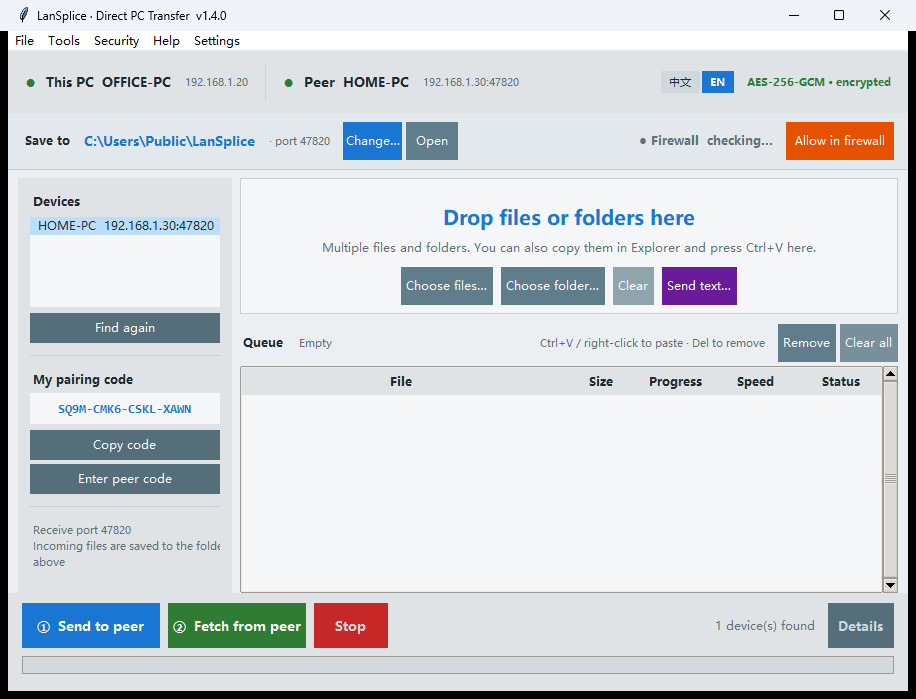

# LanSplice · Direct PC-to-PC Transfer

[简体中文](README.md) ｜ **English**

Push files and folders straight onto the other PC's disk — both machines on the same LAN.
**No cloud drive, no Windows file sharing (SMB), no USB stick.** The UI ships in Chinese and
English, switchable from the home screen.



**[⬇ Download LanSplice.exe](https://github.com/podcatcher962/LanSplice/releases/latest)** —
one 16 MB file, no installer, runs on both 32-bit and 64-bit Windows.

Author: © Lanlan Eternal (永远的兰兰)

---

## Requirements

| OS | Status |
|---|---|
| **Windows 11** (64-bit) | ✅ Supported |
| **Windows 10** (32-bit / 64-bit) | ✅ Supported — main dev & test environment |
| Windows 8.1 | ⚠️ Very likely works, not tested |
| Windows 7 and older | ❌ Not supported |

**One file, no decision to make: `LanSplice-v1.3.3.exe`.**

It is a 32-bit build. 64-bit Windows runs it natively through WoW64 — double-click and it
just works. Task Manager will label it "(32 bit)"; that is expected. **You never need to know
whether your PC is 32- or 64-bit**: the same file serves both.

Why a single package:

| | 32-bit build (shipped) | 64-bit build |
|---|---|---|
| 32-bit Windows | ✅ Runs | ❌ Cannot run |
| 64-bit Windows | ✅ Runs | ✅ Runs |
| Loopback throughput | 126 MB/s | 186 MB/s |
| Real gigabit LAN | ≈ 87 MB/s (line-saturated) | ≈ 87 MB/s (line-saturated) |
| Peak memory | 25 MB | 31 MB |

A gigabit link tops out around 118 MB/s in theory and ~87 MB/s in practice; both builds are
bottlenecked by the wire, so **the user experience is identical**. One file means nobody
downloads the wrong one.

The only trade-off: on a future 2.5G / 10G network the 32-bit build hits its ceiling first
(~126 MB/s). Ask the author for the native 64-bit build if you ever get there.

**Why Windows 10 is the floor:** the packages are built with Python 3.12 / 3.9, whose official
minimum is Windows 8.1. Windows 7 lacks required system APIs and the binary will not start.
Windows 7 has also been out of security support for years — running a program that opens
network ports on it is a bad idea regardless.

---

## The problem it solves

| | USB stick | Cloud drive | **LanSplice** |
|---|---|---|---|
| Measured 8.93 GB transfer | 2–5 min + walking back and forth | 35–45 min | **~2 min** |
| Manual work | Plug, walk, copy | Upload, wait, download, extract | Drag in, click once |
| Incremental (only new files) | Pick them yourself | Pick them yourself | **Skipped automatically** |
| Data passes a third party | No, but the stick carries malware | **Yes** | No |
| Transport encryption | None | Whatever the platform does | **AES-256-GCM** |
| Needs internet | No | Yes | No |

Measured **87 MB/s** over gigabit Ethernet with full-frame AES-256-GCM encryption (≈700 Mbps);
the bottleneck is usually disk read speed, not the network.

---

## Bilingual UI

Two small buttons — **「中文」 / 「EN」** — sit at the top right of the home screen. Click one and
the whole interface switches instantly, no restart.

- The pending list, device list and selected peer **all survive the switch**
- The choice is saved to config and restored next launch
- First run follows the system language: Chinese Windows → Chinese, anything else → English
- Switching is blocked while a transfer is running (avoid mixing progress numbers with status text)

In English mode the window title becomes `LanSplice · Direct PC Transfer`; menus, dialogs,
help, diagnostics and logs are all English — no half-translated screens.

---

## Usage

### First time (once per machine)

1. Double-click `LanSplice.exe` on both machines.

   **The first launch triggers a Windows Security Alert asking to allow network access —
   click "Allow".** Then do one more step: click **"Allow through firewall"** on the second row
   of the home screen and confirm the UAC prompt. This replaces the loose rule Windows created
   automatically with strict rules (internal subnets only, this program only). No more prompts
   at boot, and no open port when you take the laptop to a café. The indicator turns green:
   **"Firewall · Allowed"**.

   > Why this is required, and why it can never expose your PC to the internet, is explained in
   > [The firewall thing](#the-firewall-thing). It is the only place the app needs administrator
   > rights — worth two minutes of reading.

2. The left side shows a **pairing code** like `K7QM-9XRA-2LFD-T8EW`.
3. Click **"Copy code"**, go to the other machine, click **"Enter peer's code"** and paste.
   Either direction works — both machines just need to end up with the same code.
4. **Tools → Find devices again**, then select the peer in the list.

Peer not found? Make sure both apps are open, then check that the firewall indicator is green.

### Every transfer

1. **Drag files or folders into the dashed box** (or use "Choose files…" / "Choose folder…",
   both multi-select). Even quicker: `Ctrl+C` in Explorer, then `Ctrl+V` in the window — items go
   straight into the list, duplicates are skipped. **Right-click the list** for the same paste
   plus "Add files… / Add folder… / Remove selected / Clear all".
2. Click **"① Send to peer"**.
3. Watch the progress bar. The bottom right states **which machine, which folder, how much, how
   long, how fast**; the **"Details"** button shows the full list and the remote destination.

   In the details window, **"Open folder on peer"** makes the *other* PC pop up Explorer at its
   receive folder — no walking over, no SMB, no credentials. It travels over the same encrypted
   channel. (Requires v1.2.2+ on both sides.)

Files land in the peer's **receive folder** (default `E:\_xfer`) with the directory structure
preserved. The "Save to" row on the home screen lets you change it or open it.

Files with the same name, size and modification time are skipped, never re-sent.

**Completed items are removed from the list automatically**; failed or cancelled ones stay so you
can retry. The list supports Ctrl / Shift multi-select, `Delete` or "Remove selected" removes only
those rows; "Clear all" empties everything. Double-click a row to reveal it in Explorer.

---

## The firewall thing

This section is for anyone thinking *"I'm not punching a hole in my PC just to copy a file."*

### Why the allowance is needed

Windows Firewall's default policy is: **drop every inbound connection**. That is good, but it
cannot tell "someone is stealing my data" from "my other PC next door wants to send me a file".

Both things LanSplice does are **inbound**:

| Port | Purpose | Direction |
|---|---|---|
| TCP 47820 | Peer connects to send files | Inbound |
| UDP 47821 | Broadcast device discovery ("I'm here", "are you there?") | Inbound |

Without the allowance the other side cannot see you, and a manually typed IP times out.
**The most common failure — same subnet, network fine, still cannot connect — is exactly this.**

Note: **allowing ≠ disabling the firewall.** The firewall keeps working; it just opens one door
for this one program's two ports, with a guard standing at it (internal sources only, see below).

### What "Allow through firewall" actually changes

The app asks for elevation once, then does four things:

1. **Deletes** the permissive rule Windows created on first launch (that one allows any program
   from any source — that is the rule actually worth worrying about)
2. Creates **two** rules, both scoped to this executable:
   - `LanSplice-TCP`: TCP 47820, **inbound only**
   - `LanSplice-UDP`: UDP 47821, **inbound only**
3. Each rule carries three restrictions:
   - **Program**: only `LanSplice.exe` — no other software on the machine can borrow these ports
   - **Remote address**: only `192.168.0.0/16`, `10.0.0.0/8`, `172.16.0.0/12` plus `127.0.0.1`
   - **Direction**: inbound only; outbound rules untouched
4. Re-binds the listening socket so the new rules apply immediately (no restart needed)

### Why this can never expose your PC to the internet

Layer by layer, each one alone would be enough:

| Layer | What it stops |
|---|---|
| Windows Firewall | Packets whose source is not a private range are **dropped outright** — the app never even sees them. Every public IP is eliminated here |
| Rule scope | Only the `LanSplice.exe` file; the ports are not opened to other local programs |
| Port count | Exactly two, both inbound. No web server, no RDP, no file sharing |
| App behaviour | It **never dials out**, does no UPnP, no port mapping, no NAT traversal — it cannot open a door for itself |
| Router | Home routers NAT by default: the internet cannot reach any LAN host unless *you* add a port forward |
| Crypto | Even if someone on the LAN finds port 47820, they must pass X25519 + pairing-code HMAC; without the code not a single byte gets in |

In one sentence: **it opens a door only family members can walk through, and the door is locked.**

### Verify it yourself (optional)

```powershell
Get-NetFirewallRule -DisplayName 'LanSplice-*' | Get-NetFirewallAddressFilter
Get-NetFirewallRule -DisplayName 'LanSplice-*' | Get-NetFirewallApplicationFilter
```

The first should show three private ranges + 127.0.0.1, never `Any`.
The second should show only the full path to your `LanSplice.exe`.

In-app: **Tools → Security check** lists rule names, enable state and scope.

### When you must allow again

- The exe moved (renamed, moved folder, extracted elsewhere) — rules store the full path
- You upgraded to a new version in a new folder
- You clicked "No" on the UAC prompt

Just click allow once more; old rules are deleted and rebuilt, they never pile up.

---

## Security design

No Windows file sharing involved — **port 445 is never touched**.

| Stage | Approach |
|---|---|
| Discovery | UDP broadcast, returns hostname and port only, **no key material** |
| Authentication | Pairing-code-derived key + X25519 key exchange + mutual HMAC |
| Channel | AES-256-GCM, independent keys per direction, sequence number as nonce (anti-replay) |
| Source filter | Private IPv4 ranges only; public IPv4 / IPv6 rejected |
| Firewall | Two inbound rules, program-scoped and source-scoped |
| Write scope | Confined to the receive folder; `..`, drive letters, `CON`/`NUL` reserved names blocked |
| Remote open | Only the receive folder and its children; `..`, drive letters, anything above it rejected; refuses to open anything if the receive folder is gone |
| Partial files | Written as `.l2ptmp`, renamed only after byte-count verification |

**The pairing code is the password.** Don't post it in group chats, don't screenshot it.
If leaked: **Security → Regenerate pairing code**.

Don't double-click `.exe` / `.bat` / `.lnk` files received from a peer — same rule as USB sticks.
This app does not scan for malware.

---

## About IP addresses

**Ignore them.** Device discovery uses UDP broadcast, so whatever IP the router hands out works.

You only need a manual address if the router has AP isolation / guest isolation enabled and
broadcast cannot get through: **Tools → Enter peer address manually**, e.g. `192.168.1.20:47820`.

To pin addresses, use DHCP reservation on the router (bind MAC to IP) rather than static IPs in
Windows — simpler and less error-prone.

---

## FAQ

**Peer not found?** Both apps running; firewall allowed; same router (not the guest network).

**Do I have to open the other side first?** Up to v1.1.3, yes — the receiver only answered, never
announced, so whichever machine started first could not see the later one. Since v1.1.4 the
receiver broadcasts "I'm here" every 8 seconds and the other side adds it automatically.
**Start in any order**; the later machine appears within 8 seconds.

**Allowed the firewall but still had to restart the app?** Up to v1.1.2. Windows does not apply
new rules to an already-listening socket. Since v1.1.3 the app re-binds automatically (~0.4 s).

**Two windows open?** The second one cannot bind the port; the status bar says "port in use,
retrying in 2 s", and after three attempts it asks you to close the extra window.

**Slow — only 7–10 MB/s?** Check both sides are wired (Wi-Fi drops below 10 MB/s). If wired,
check both are v1.1.2+ — earlier builds lacked `TCP_NODELAY`, so Nagle and Windows delayed ACK
stalled each other and crushed gigabit to 7 MB/s.

**Can I browse the peer's disk from here?** No, and that is deliberate — browsing a remote disk
requires SMB, which this app avoids. "Open folder on peer" makes the peer open its own Explorer.

**Works over the internet?** No, by design. It only serves two machines you own behind one router.
That is also why it is safe: the internet cannot reach it.

**Why did a `127.0.0.1` device show up?** Fixed in v1.2.5. Broadcast copies loop back to the local
socket with a loopback source address; old builds compared network-adapter addresses only and
mistook their own packet for a peer. Loopback now always counts as self, plus an instance ID in
the announcement.

**Where is the config?** `%APPDATA%\LanSplice\config.json` — pairing code, receive folder, ports,
language. Upgrading from the old name (`Link2PC`) migrates it automatically on first run.

**Port in use?** Defaults are TCP 47820 / UDP 47821. Changing them requires matching values on
both sides.

---

## Disclaimer

For transferring files between devices you own on the same LAN. Do not use it for illegal content.
The author is not liable for any data loss or legal consequences arising from use of this software.

---

## Tech stack

Python 3.12 + tkinter + tkinterdnd2 + cryptography, packaged as a single file with PyInstaller
(the 32-bit build uses Python 3.9, producing one exe that serves 32- and 64-bit Windows).

- `link2pc_core.py` — protocol, crypto, transfer, discovery
- `link2pc_gui.py` — UI
- `link2pc_i18n.py` — Chinese/English string tables
- `BAT方案-备用/` — early SMB-script approach, kept for reference only

> Source files keep the `link2pc` prefix: renaming the modules would ripple through every import,
> build spec and test, and users never see these filenames. The product name appears only in the
> UI, the config folder and the firewall rules.

**Build it yourself** (three .py files in one directory):

```bash
pip install cryptography tkinterdnd2 pyinstaller
pyinstaller -F -w --name LanSplice \
  --collect-all tkinterdnd2 --icon app.ico link2pc_gui.py
```

An exe produced by 32-bit Python runs on both 32- and 64-bit Windows.

---

## Changelog

**v1.3.3** — English buttons no longer truncated
- English labels are longer than Chinese, and several buttons had a hard-coded character width,
  so they rendered as `move select` / `Choose folder.` — clipped at both ends. Buttons now size
  to their text
- "Remove selected" shortened to "Remove"; the queue hint line shortened too, so nothing crowds
- Two developer-side fixes: `PeerServer._handle` collided with Python 3.13's internal
  `Thread._handle` attribute (overwritten by a thread handle, so the source build crashed on the
  first accepted connection); and the build spec now bundles the two OpenSSL DLLs explicitly, so
  a `--clean` rebuild cannot drop them
- Added English UI screenshot and a development-history document

**v1.3.2** — removed the red error text from "Allow through firewall"
- Symptom: after clicking allow, a line like `Continue='SilentlyContinue' : not recognized as a
  cmdlet` appeared. It looked like a failure, but the rules were created
- Cause: the script was embedded in an outer PowerShell **double-quoted string**, so the outer
  layer expanded variables first (`$ErrorActionPreference` → its current value `Continue`, `$_` →
  empty). The inner script arrived corrupted
- Fix: pass the script via `-EncodedCommand` (base64), immune to outer parsing; the elevated
  window is hidden too, no more black flash
- Also fixed: `/n/n` shown instead of a newline in the English firewall note
- If you allowed before, old rules may contain a double-backslash program path; one click on the
  new version clears and rebuilds them

**v1.3.1** — single package + fixed 32-bit handshake failure
- Ships one `LanSplice-v1.3.1.exe` (32-bit build) that runs on 32- and 64-bit Windows, so users no
  longer have to know their bitness
- **Serious fix**: the v1.3.0 32-bit build opened its window but dropped the connection during the
  handshake — it could not transfer anything. The 32-bit environment ships cryptography 3.6, and
  `public_bytes_raw()` requires 4.0+; replaced with an API both old and new versions support
- Acceptance improved: no longer just "the window opens" — the packaged exe receives a real 24 MB
  file and the SHA-256 is verified

**v1.3.0** — renamed to LanSplice + bilingual UI + 32-bit build
- `Link2PC` → **LanSplice**. The old name conflicts: Jeio Tech ships `LC Link2PC`, AOL used the
  name in 2006, and search results get buried
- Bilingual UI with one-click switching, list and device state preserved, choice persisted
- New 32-bit (x86) build for older machines; mixed bitness works
- Firewall rules tightened further with `-Program`, scoped to this executable
- Config moved to `%APPDATA%\LanSplice`, auto-migrated from the old folder
- Rewritten firewall documentation: why, what changes, why it never reaches the internet

**v1.2.5** — list context menu + fixed the `127.0.0.1` ghost device
**v1.2.4** — `Ctrl+V` pastes files from Explorer into the pending list
**v1.2.3** — fixed detail-window buttons clipped by the window's bottom edge
**v1.2.2** — "Open folder on peer" after a transfer
**v1.2.1** — home screen reorganized around the real workflow
**v1.1.5** — peer stayed red after auto-discovery; duplicate rows for one host
**v1.1.4** — receiver announces every 8 s, order of startup no longer matters
**v1.1.3** — auto re-bind after allowing the firewall
**v1.1.2** — `TCP_NODELAY`, gigabit restored from 7 MB/s to 87 MB/s
**v1.1.1** — multi-adapter broadcast, public-network handling, connection diagnostics
**v1.1.0** — first usable release
**v1.0** — first prototype (SMB script approach retired the same day)
