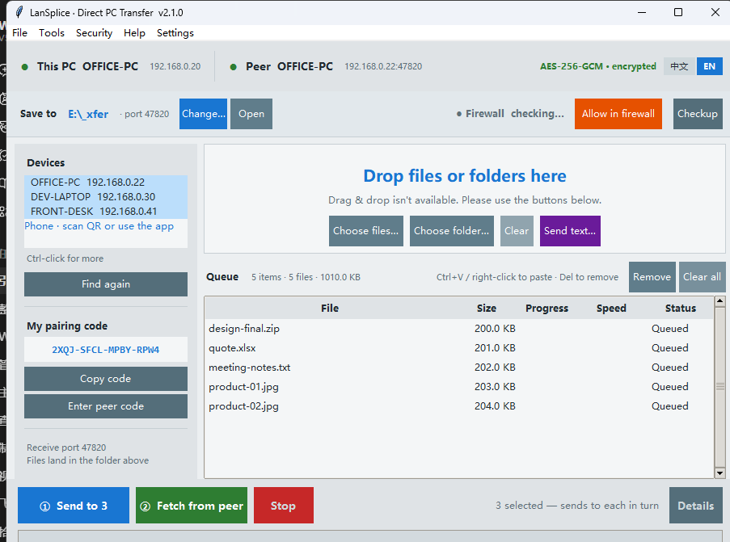
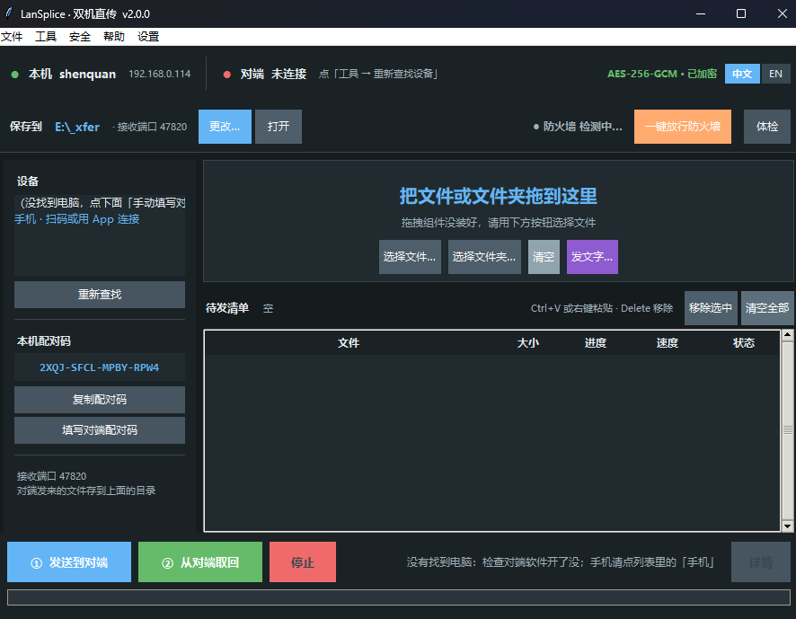
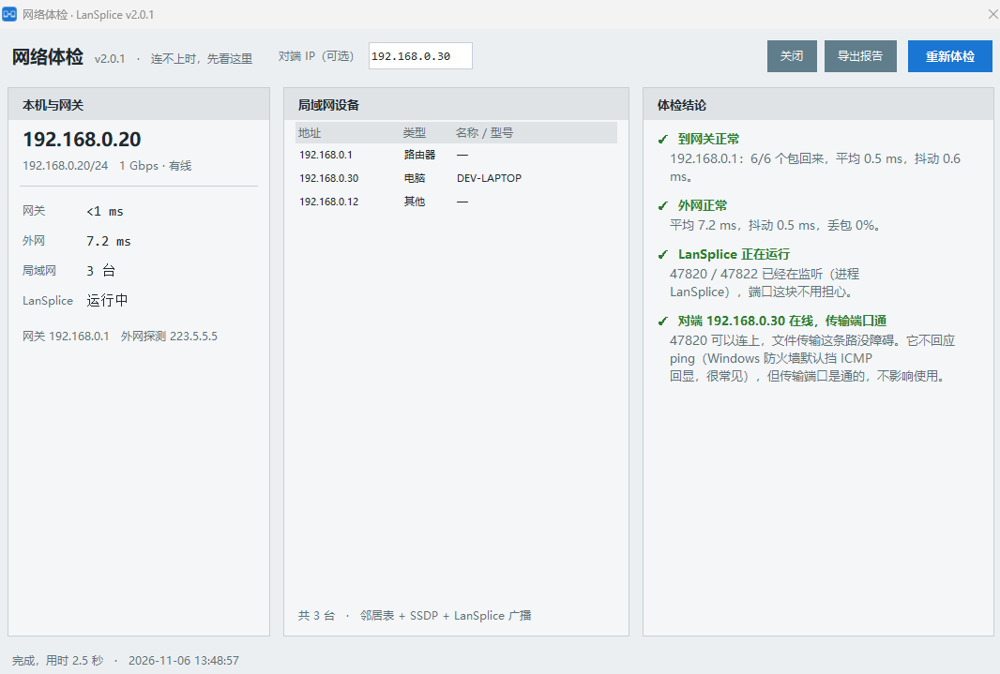
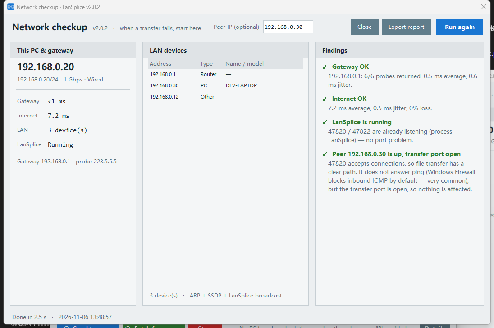
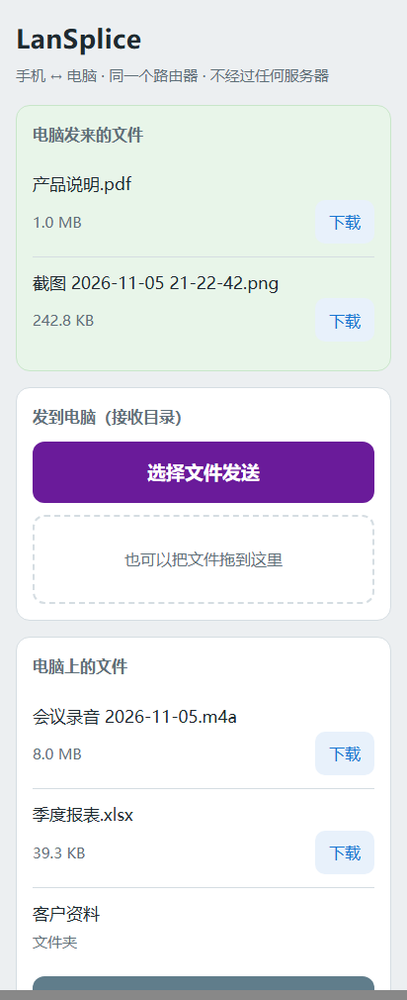

# LanSplice · Direct PC-to-PC Transfer

[简体中文](README.zh-CN.md) ｜ **English**

Two PCs on the same router and the same subnet can push files, folders or text straight to each
other, and chat in a window on the peer side. There is no client and no server — nothing in
between.

No Windows file sharing, no USB stick. On Windows it is one exe — no Python to install.
Verified on a real UnionTech UOS 20 machine; Kylin, Deepin and Ubuntu use the same offline
package and install without a network.

First time takes five steps: open the app on both PCs, enter one PC's pairing code on the
other, click "Find again" on the left, drag your files into the dashed box, then click
"① Send to peer" at the bottom left. If the other PC doesn't show up, click
"Allow in firewall" at the bottom right.

Interrupted transfers resume where they stopped, and a file already on the other side is never
overwritten. Closing the window only minimises to the tray — receiving keeps running.

More than two machines? The device list is multi-select: Ctrl-click five PCs, drop the files in
once, and one Send walks through them in turn, reporting a per-device result at the end.




The app opens in the light theme by default. A dark theme is included (Tools → Theme:
Light / Dark / Follow system) — on the desktop app, the phone web page and the Android client
alike, and switching never interrupts a transfer:



When a transfer will not connect, the "Checkup" button at the right end of the quick bar tells
you which layer failed: local adapter, gateway, internet, port in use, peer online. Evidence on
the left, verdict and next step on the right:



The window and every finding in it follow the interface language, and so does the exported
HTML report:



**[⬇ Download LanSplice.exe](https://github.com/podcatcher962/LanSplice/releases/latest)** —
one 13.8 MB file, no installer, runs on both 32-bit and 64-bit Windows.

Want to receive on a phone too? Install the **53 KB Android app** — `LanSplice-1.9.2.apk`
(same download page). No cable, no cloud drive: tap Share on a photo, pick it, and the photo
lands straight in the receive folder on your PC.

Author: © Lanlan Eternal (永远的兰兰)

---

## Requirements

| OS | Status |
|---|---|
| **Windows 11** (64-bit) | ✅ Supported |
| **Windows 10** (32-bit / 64-bit) | ✅ Supported — main dev & test environment |
| Windows 8.1 | ⚠️ Very likely works, not tested |
| Windows 7 and older | ❌ Not supported |
| **UOS / Kylin V10 / Deepin / Ubuntu** | ✅ Supported (GUI + CLI), see [docs/linux.md](docs/linux.md) |
| Phytium / Kunpeng / Loongson | ⚠️ Protocol is architecture-agnostic, but **not yet tested on real hardware** |
| macOS (Intel / Apple Silicon) | ⚠️ Native build available, **but not verified on a real Mac yet**: run from source, or build a `.app` with `build_macos.sh`; see [docs/macos.md](docs/macos.md) (no Mac? use browser mode: [docs/mac-now.md](docs/mac-now.md)) |

**One file, no decision to make: `LanSplice-v2.1.0.exe`.**

It is a 32-bit build. 64-bit Windows runs it natively through WoW64 — double-click and it
just works. Task Manager will label it "(32 bit)"; that is expected. **You never need to know
whether your PC is 32- or 64-bit**: the same file serves both.

Why a single package:

| | 32-bit build (shipped) | 64-bit build |
|---|---|---|
| 32-bit Windows | ✅ Runs | ❌ Cannot run |
| 64-bit Windows | ✅ Runs | ✅ Runs |
| Loopback throughput | 126 MB/s | 186 MB/s |
| Real gigabit LAN | ≈ 87 MB/s (line-saturated) | ≈ 87 MB/s (line-saturated) |
| Peak memory | 25 MB | 31 MB |

A gigabit link tops out around 118 MB/s in theory and ~87 MB/s in practice; both builds are
bottlenecked by the wire, so **the user experience is identical**. One file means nobody
downloads the wrong one.

The only trade-off: on a future 2.5G / 10G network the 32-bit build hits its ceiling first
(~126 MB/s). Ask the author for the native 64-bit build if you ever get there.

**Why Windows 10 is the floor:** the packages are built with Python 3.12 / 3.9, whose official
minimum is Windows 8.1. Windows 7 lacks required system APIs and the binary will not start.
Windows 7 has also been out of security support for years — running a program that opens
network ports on it is a bad idea regardless.

---

## The problem it solves

| | USB stick | Cloud drive | **LanSplice** |
|---|---|---|---|
| Measured 8.93 GB transfer | 2–5 min + walking back and forth | 35–45 min | **~2 min** |
| Manual work | Plug, walk, copy | Upload, wait, download, extract | Drag in, click once |
| Incremental (only new files) | Pick them yourself | Pick them yourself | **Skipped automatically** |
| Data passes a third party | No, but the stick carries malware | **Yes** | No |
| Transport encryption | None | Whatever the platform does | **AES-256-GCM** |
| Needs internet | No | Yes | No |

Measured **87 MB/s** over gigabit Ethernet with full-frame AES-256-GCM encryption (≈700 Mbps);
the bottleneck is usually disk read speed, not the network.

---

## Bilingual UI

Two small buttons — **「中文」 / 「EN」** — sit at the top right of the home screen. Click one and
the whole interface switches instantly, no restart.

- The pending list, device list and selected peer **all survive the switch**
- The choice is saved to config and restored next launch
- First run follows the system language: Chinese Windows → Chinese, anything else → English
- Switching is blocked while a transfer is running (avoid mixing progress numbers with status text)

In English mode the window title becomes `LanSplice · Direct PC Transfer`; menus, dialogs,
help, diagnostics and logs are all English — no half-translated screens.

---

## Usage

### First time (once per machine)

1. Double-click `LanSplice.exe` on both machines.

   **The first launch triggers a Windows Security Alert asking to allow network access —
   click "Allow".** Then do one more step: click **"Allow through firewall"** on the second row
   of the home screen and confirm the UAC prompt. This replaces the loose rule Windows created
   automatically with strict rules (internal subnets only, this program only). No more prompts
   at boot, and no open port when you take the laptop to a café. The indicator turns green:
   **"Firewall · Allowed"**.

   > Why this is required, and why it can never expose your PC to the internet, is explained in
   > [The firewall thing](#the-firewall-thing). It is the only place the app needs administrator
   > rights — worth two minutes of reading.

2. The left side shows a **pairing code** like `K7QM-9XRA-2LFD-T8EW`.
3. Click **"Copy code"**, go to the other machine, click **"Enter peer's code"** and paste.
   Either direction works — both machines just need to end up with the same code.
4. **Tools → Find devices again**, then select the peer in the list.

Peer not found? Make sure both apps are open, then check that the firewall indicator is green.

### Every transfer

1. **Drag files or folders into the dashed box** (or use "Choose files…" / "Choose folder…",
   both multi-select). Even quicker: `Ctrl+C` in Explorer, then `Ctrl+V` in the window — items go
   straight into the list, duplicates are skipped. **Right-click the list** for the same paste
   plus "Add files… / Add folder… / Remove selected / Clear all".
2. Click **"① Send to peer"**.
3. Watch the progress bar. The bottom right states **which machine, which folder, how much, how
   long, how fast**; the **"Details"** button shows the full list and the remote destination.

   In the details window, **"Open folder on peer"** makes the *other* PC pop up Explorer at its
   receive folder — no walking over, no SMB, no credentials. It travels over the same encrypted
   channel. (Requires v1.2.2+ on both sides.)

Files land in the peer's **receive folder** (default `E:\_xfer`) with the directory structure
preserved. The "Save to" row on the home screen lets you change it or open it.

Files with the same name, size and modification time are skipped, never re-sent.

**Completed items are removed from the list automatically**; failed or cancelled ones stay so you
can retry. The list supports Ctrl / Shift multi-select, `Delete` or "Remove selected" removes only
those rows; "Clear all" empties everything. Double-click a row to reveal it in Explorer.

---

## Folder mirror

Everything above is *"here are the files I want to send this time"*. If what you actually want is
*"keep these two folders in sync"*, use **Tools → Mirror a folder…**:

1. Pick the local folder on the left, type the peer folder on the right (an **absolute path on the
   other machine**).
2. Click Start mirror.

The rule is one sentence: **only new and changed files are copied.**

- Present here, missing there → copy
- Changed here (different size or modification time) → overwrite the copy there
- Unchanged → skipped, no bandwidth wasted
- Extra files on the peer side → **never deleted**. A mirror only ever adds; removing files stays
  your decision

The status line reports "scanned 1,234 files, 17 to copy, 2.1 GB total" before it starts moving
anything, so you know the size of the job up front.

Files changed locally are **overwritten in place**. This is deliberately different from a normal
send: a normal send always writes `clip (2).ext` and never touches what is already there, whereas
a mirror means "make the two sides the same" — renaming would just pile up `(2)`, `(3)`, `(4)` on
the peer.

---

## Auto-sync

A mirror is a one-off job. If you want a folder to keep following you, use
**Tools → Auto-sync…**:

1. Click Add…, pick a local folder, then type the subfolder name under the peer's receive folder
   (leave it empty to reuse the folder name).
2. Leave the program running. That is all.

Same add-only rule as the mirror, plus two more:

- Files you delete locally are **kept on the peer**. Deletion is irreversible, and an extra copy
  is almost never a bad thing
- Files still being written are **not sent**. A file must look identical across two consecutive
  scans (6 seconds apart) before anything moves — so a file you just saved arrives a few seconds
  later, and you never get half a file

The status column reads "Synced 12 (3.4 MB)". Closing the window does not stop syncing; untick
"Sync while running" to stop. With no peer selected the job stays quiet instead of filling the
status bar with errors.

---

## Command line

The same exe also takes plain commands, which is handy in batch files, scheduled tasks, or when
another script needs to push a file.

```bat
:: send one file
LanSplice.exe send "D:\video\sample.mp4" --to 192.168.1.20

:: send a whole folder (structure preserved on the peer)
LanSplice.exe send "D:\assets" --to 192.168.1.20

:: wildcards
LanSplice.exe send "D:\logs\*.log" --to 192.168.1.20

:: scan the LAN for machines running LanSplice
LanSplice.exe devices

:: act as a receiver only (no window, just wait)
LanSplice.exe serve --root "D:\inbox"

:: version
LanSplice.exe version
```

| Flag | Meaning |
|---|---|
| `--to ip[:port]` | Peer address, required. Port defaults to `47820` |
| `--code XXXX-XXXX-XXXX-XXXX` | Pairing code; falls back to the one saved in local config |
| `--overwrite` | Replace a same-named file on the peer (default writes `clip (2).ext`) |
| `--verify` | Re-read the whole file on both ends after transfer (slower, catches disk errors) |

`send` prints a progress bar per file and a summary of how many were sent, skipped and how long it
took.

**There are three exit codes** — a scheduled task uses this to decide whether a rerun makes sense:

| Exit code | Meaning | What to do |
|---|---|---|
| `0` | everything succeeded (including "already there, skipped") | nothing |
| `1` | some files went through, some failed | worth rerunning; resume picks up where it stopped |
| `2` | nothing started: peer unreachable, or wrong pairing code | read the message first, don't just rerun |

`2` is kept apart from `1` because the two need opposite reactions: a wrong pairing code will fail
identically a hundred times, while a half-finished transfer only needs to be started again. A batch
script can retry only on `1`.

When it cannot connect, it says which of the two situations you are in:

```
Cannot reach 192.168.1.20:47820 — nothing is listening there.
The other machine most likely has LanSplice closed, or this is not its current address

192.168.1.20:47820 gave no answer — the two machines may not be on the same router,
or the peer is blocked by its firewall. Check that both use the same Wi-Fi or router, then try again
```

And it decides within **3.5 seconds**. It used to wait 8 seconds, which together with the five
seconds a single-file exe needs to unpack meant staring at a blank screen for well over ten seconds
after clicking send — indistinguishable from a hang.

Launching with **no arguments at all** opens the normal GUI; nothing about the old habit changes.

---

## Linux / domestic (Xinchuang) systems

The same code runs on Linux with **both the GUI and command line**.
UOS, Kylin V10, Deepin, Ubuntu, Debian, CentOS and openEuler all work; Phytium / Kunpeng (ARM64),
Hygon / Zhaoxin (x86_64) and Loongson (LoongArch) interoperate without ceremony, because the
protocol is byte-level and does not care about the CPU.

Download **[LanSplice-2.1.0-linux-kit.tar.gz](https://github.com/podcatcher962/LanSplice/releases/latest/download/LanSplice-2.1.0-linux-kit.tar.gz)** (~3.2 MB, ships the offline dependency wheels), extract it, then:

```sh
sudo sh install.sh

lansplice                                    # open the GUI
lansplice serve                              # receive; prints the pairing code
lansplice send report.xlsx --to 192.168.1.20 # send to a Windows box
lansplice devices                            # who is listening on this LAN
```

- **UOS 20 x86_64 installs fully offline**: the complete kit carries the crypto
  dependencies for Python 3.7, with no pip, working apt repository or Internet required.
  Other distributions continue to prefer the system `cryptography` package
- Verified on **UOS 20 Professional / Python 3.7.3** with 42 real-Linux checks covering
  crypto round trips, Chinese filenames, subdirectories, NIC enumeration, single instance,
  autostart files and GUI startup
- Installed as a directory, not a single file: Kylin enables SELinux by default, and a
  single-file binary unpacking itself into `/tmp` gets blocked
- Config lives in `~/.config/LanSplice`; transfer history in `~/.local/share/LanSplice`
- Open **TCP 47820** (transfers) and **UDP 47821** (discovery) in the firewall

**Both machines must use the same pairing code.** `serve` prints the local one at startup —
paste it into Windows under File → Enter pairing code, or go the other way and pass the
Windows code with `--code`.

`serve --once` exits after a single batch, which makes it usable from scripts: exit code `0`
means something was received, `1` means nothing was. See [docs/linux.md](docs/linux.md) for
details and troubleshooting.

---

## The firewall thing

This section is for anyone thinking *"I'm not punching a hole in my PC just to copy a file."*

### Why the allowance is needed

Windows Firewall's default policy is: **drop every inbound connection**. That is good, but it
cannot tell "someone is stealing my data" from "my other PC next door wants to send me a file".

Both things LanSplice does are **inbound**:

| Port | Purpose | Direction |
|---|---|---|
| TCP 47820 | Peer connects to send files | Inbound |
| UDP 47821 | Broadcast device discovery ("I'm here", "are you there?") | Inbound |

Without the allowance the other side cannot see you, and a manually typed IP times out.
**The most common failure — same subnet, network fine, still cannot connect — is exactly this.**

Note: **allowing ≠ disabling the firewall.** The firewall keeps working; it just opens one door
for this one program's two ports, with a guard standing at it (internal sources only, see below).

### What "Allow through firewall" actually changes

The app asks for elevation once, then does four things:

1. **Deletes** the permissive rule Windows created on first launch (that one allows any program
   from any source — that is the rule actually worth worrying about)
2. Creates **two** rules, both scoped to this executable:
   - `LanSplice-TCP`: TCP 47820, **inbound only**
   - `LanSplice-UDP`: UDP 47821, **inbound only**
3. Each rule carries three restrictions:
   - **Source address**: only the three private ranges plus `127.0.0.1`. No `Any`.

Rules are **port-scoped, not program-scoped** since v1.7.3: one rule covers every
future version, so upgrading no longer asks you to allow it again.
   - **Remote address**: only `192.168.0.0/16`, `10.0.0.0/8`, `172.16.0.0/12` plus `127.0.0.1`
   - **Direction**: inbound only; outbound rules untouched
4. Re-binds the listening socket so the new rules apply immediately (no restart needed)

### Why this can never expose your PC to the internet

Layer by layer, each one alone would be enough:

| Layer | What it stops |
|---|---|
| Windows Firewall | Packets whose source is not a private range are **dropped outright** — the app never even sees them. Every public IP is eliminated here |
| Rule scope | Only TCP 47820 / UDP 47821, only from LAN sources; no other port touched |
| Port count | Exactly two, both inbound. No web server, no RDP, no file sharing |
| App behaviour | It **never dials out**, does no UPnP, no port mapping, no NAT traversal — it cannot open a door for itself |
| Router | Home routers NAT by default: the internet cannot reach any LAN host unless *you* add a port forward |
| Crypto | Even if someone on the LAN finds port 47820, they must pass X25519 + pairing-code HMAC; without the code not a single byte gets in |

In one sentence: **it opens a door only family members can walk through, and the door is locked.**

### Verify it yourself (optional)

```powershell
Get-NetFirewallRule -DisplayName 'LanSplice-*' | Get-NetFirewallAddressFilter
Get-NetFirewallRule -DisplayName 'LanSplice-*' | Get-NetFirewallApplicationFilter
```

The first should show three private ranges + 127.0.0.1, never `Any`.
The second should show only the full path to your `LanSplice.exe`.

In-app: **Tools → Security check** lists rule names, enable state and scope.

### When you must allow again

- The exe moved (renamed, moved folder, extracted elsewhere) — rules store the full path
- You upgraded to a new version in a new folder
- You clicked "No" on the UAC prompt

Just click allow once more; old rules are deleted and rebuilt, they never pile up.

---

## Security design

No Windows file sharing involved — **port 445 is never touched**.

| Stage | Approach |
|---|---|
| Discovery | UDP broadcast, returns hostname and port only, **no key material** |
| Authentication | Pairing-code-derived key + X25519 key exchange + mutual HMAC |
| Channel | AES-256-GCM, independent keys per direction, sequence number as nonce (anti-replay) |
| Source filter | Private IPv4 ranges only; public IPv4 / IPv6 rejected |
| Firewall | Two inbound rules, two ports only, source-scoped to LAN |
| Write scope | Confined to the receive folder; `..`, drive letters, `CON`/`NUL` reserved names blocked |
| Remote open | Only the receive folder and its children; `..`, drive letters, anything above it rejected; refuses to open anything if the receive folder is gone |
| Partial files | Written as `.l2ptmp`, renamed only after byte-count verification |

**The pairing code is the password.** Don't post it in group chats, don't screenshot it.
If leaked: **Security → Regenerate pairing code**.

Don't double-click `.exe` / `.bat` / `.lnk` files received from a peer — same rule as USB sticks.
This app does not scan for malware.

---

## About IP addresses

**Ignore them.** Device discovery uses UDP broadcast, so whatever IP the router hands out works.

You only need a manual address if the router has AP isolation / guest isolation enabled and
broadcast cannot get through: **Tools → Enter peer address manually**, e.g. `192.168.1.20:47820`.

To pin addresses, use DHCP reservation on the router (bind MAC to IP) rather than static IPs in
Windows — simpler and less error-prone.

---

## FAQ

**Peer not found?** Both apps running; firewall allowed; same router (not the guest network).

**Do I have to open the other side first?** Up to v1.1.3, yes — the receiver only answered, never
announced, so whichever machine started first could not see the later one. Since v1.1.4 the
receiver broadcasts "I'm here" every 8 seconds and the other side adds it automatically.
**Start in any order**; the later machine appears within 8 seconds.

**Allowed the firewall but still had to restart the app?** Up to v1.1.2. Windows does not apply
new rules to an already-listening socket. Since v1.1.3 the app re-binds automatically (~0.4 s).

**Two windows open?** The second one cannot bind the port; the status bar says "port in use,
retrying in 2 s", and after three attempts it asks you to close the extra window.

**Slow — only 7–10 MB/s?** Check both sides are wired (Wi-Fi drops below 10 MB/s). If wired,
check both are v1.1.2+ — earlier builds lacked `TCP_NODELAY`, so Nagle and Windows delayed ACK
stalled each other and crushed gigabit to 7 MB/s.

**Can I browse the peer's disk from here?** No, and that is deliberate — browsing a remote disk
requires SMB, which this app avoids. "Open folder on peer" makes the peer open its own Explorer.

**Works over the internet?** No, by design. It only serves two machines you own behind one router.
That is also why it is safe: the internet cannot reach it.

**Why did a `127.0.0.1` device show up?** Fixed in v1.2.5. Broadcast copies loop back to the local
socket with a loopback source address; old builds compared network-adapter addresses only and
mistook their own packet for a peer. Loopback now always counts as self, plus an instance ID in
the announcement.

**Where is the config?** `%APPDATA%\LanSplice\config.json` — pairing code, receive folder, ports,
language. Upgrading from the old name (`Link2PC`) migrates it automatically on first run.

**Port in use?** Defaults are TCP 47820 / UDP 47821. Changing them requires matching values on
both sides.

---

## Disclaimer

For transferring files between devices you own on the same LAN. Do not use it for illegal content.
The author is not liable for any data loss or legal consequences arising from use of this software.

---

## Tech stack

Python 3.12 + tkinter + tkinterdnd2 + cryptography, packaged as a single file with PyInstaller
(the 32-bit build uses Python 3.9, producing one exe that serves 32- and 64-bit Windows).

- `link2pc_core.py` — protocol, crypto, transfer, discovery
- `link2pc_gui.py` — UI
- `link2pc_i18n.py` — Chinese/English string tables
- `BAT方案-备用/` — early SMB-script approach, kept for reference only

> Source files keep the `link2pc` prefix: renaming the modules would ripple through every import,
> build spec and test, and users never see these filenames. The product name appears only in the
> UI, the config folder and the firewall rules.

**Build it yourself** (three .py files in one directory):

```bash
pip install cryptography tkinterdnd2 pyinstaller
pyinstaller -F -w --name LanSplice \
  --collect-all tkinterdnd2 --icon app.ico link2pc_gui.py
```

An exe produced by 32-bit Python runs on both 32- and 64-bit Windows.

---

## License

**MIT** — full text in [LICENSE](LICENSE).

In one line: **use it, change it, pass it on — just keep the copyright notice and the author's name.**

| You may | |
|---|---|
| ✅ Use it anywhere | Home, office, as many machines as you like |
| ✅ Modify it | No permission needed, no obligation to publish your changes |
| ✅ Redistribute it | Original or modified, free of charge |
| ✅ Include it in your own project | Commercial use is fine — MIT does not restrict purpose |

| The one thing we ask | |
|---|---|
| Keep the copyright notice | Ship the copyright line and permission notice from `LICENSE` |
| Keep the attribution | Modified builds should credit the original in About or the docs, e.g. <br>`Based on LanSplice by Lanlan Eternal (github.com/podcatcher962/LanSplice)` |
| Don't speak for the author | If your build breaks, that is not the original author's doing |

> Why MIT and not GPL/MPL: GPL requires you to publish the source when you
> **distribute** a modified build, which puts off people who only want a small
> private tweak. MIT asks for nothing except that the name stays visible — and
> that part is not optional; it is the only thing this licence asks you to do.

Third-party components (Python, tkinter, cryptography, PyInstaller) keep their own licences,
independent of this project's MIT terms.

---

---

## Changelog

**v2.1.0** — pick several devices, send once
- **Group send**: the device list is now multi-select (Ctrl-click, Shift-click). Pick five
  machines, drop the files in, hit send once — it walks through them one at a time, each with
  its own handshake, progress and skip/rename handling, and reports a per-device summary at the
  end (`✔ OFFICE-PC 3 files` / `✘ FRONT-DESK wrong pairing code`).
- Deliberately **not parallel**: one NIC and one router mean parallel sends just split the same
  bandwidth, make every progress bar jump, and possibly pop several receive prompts on the same
  peer at once. Sequential keeps "2/5 done" honest.
- If one machine fails, the queue is kept so you can resend; nothing is silently marked as sent.
- Protocol untouched — v2.1.0 still talks to 1.9.2 and the Android app.

**v2.0.3** — opens in the light theme, and the English README is now the front page
- **Light by default**: the app used to follow the system theme, so on a Windows set to dark
  mode the first launch looked nothing like the screenshots on this page. It now opens light.
  Light / Dark / Follow system are still all under Tools → Theme; a config where nobody ever
  touched the setting is migrated once, while a deliberate "Follow system" choice is left alone.
- **The repository front page is English**: this file is now the English README and the Chinese
  one moved to [`README.zh-CN.md`](README.zh-CN.md), each with a language switch at the top.

**v2.0.2** — checkup findings are in English too
- **Half-English window fixed**: the checkup window title, buttons and headers have been
  bilingual since v2.0.0, but the findings column was hard-coded Chinese returned by the rule
  functions. In the English UI the left panels were English and the whole right column was
  Chinese — and that column is the part people actually read. All 110 checkup strings
  (findings, advice, progress lines, report labels) now live in the translation table.
- **The exported HTML report follows the language** as well, including `<html lang>`, so the
  browser stops applying Chinese line-breaking rules to English text.
- **Switching language no longer rescans**: an open checkup window just re-renders its text
  in place and keeps the results it already has.

**v2.0.1** — the checkup no longer treats "ping fails" as "cannot connect"
- **Fixed a scary false alarm**: on a machine with a virtual adapter, the first verdict used
  to be a red "the peer does not even answer ping", followed immediately by a green
  "port 47820 connects fine". Both cannot be true. Windows Firewall blocks inbound ICMP by
  default but allows the port LanSplice itself opens, so an open port now means
  "online, transfer port reachable", and the silent ping is only a footnote.
- **More accurate when it really is down**: only when ICMP and both ports are silent does it
  report "no response at all".
- **The multi-NIC note is consistent now**: it claimed two adapters while listing one address
  (the virtual subnet was filtered out). Physical and virtual are listed separately.
- **No NIC note when broadcast already found the peer**: that warning now appears only when
  discovery genuinely missed.

**v2.0.0** — the network checkup is now built in: no second app when a transfer fails
- **The separate diagnostics tool is now a button in the main window.** "Checkup" sits at
  the right end of the quick bar, and Network → Network checkup… opens the same window.
  The peer IP is filled in for you.
- **Three panes, verdict first**: left is this PC and the gateway (IP, link speed, latency
  and jitter to gateway and internet), middle is who is actually on the LAN (ARP + SSDP +
  LanSplice broadcast), right is the finding — each one split into symptom / cause / what to
  change. The whole run takes 1.6 s.
- **It names the actual problem**: port 47820 taken by another program (with the process
  name), peer alive but both ports closed, phone page up but transfer port down, broadcast
  blocked while unicast works, broadcast sent out of a virtual adapter, wireless client
  isolation. These used to be guesses.
- **The report is LanSplice-branded**: one HTML file, works offline, easy to send to whoever
  is helping you.
- Why merge instead of shipping two apps: the checkup gets opened exactly when LanSplice
  cannot connect. Two executables meant copying the peer IP by hand, a second colour scheme,
  a different name on the report — constantly reminding the user these are two products,
  when they are really one job.

**v1.9.2** — the device list now has a "Phone" row; click it to scan a code
- **Why the phone was never found**: a phone is not a peer the way a PC is — it neither
  broadcasts nor listens on a port. It only shows up once you scan the code (browser) or
  install the APK. So "Find devices" will always list just the other PC. That explanation
  used to live only in the docs; now the last row of the list is **Phone · scan QR or use
  the app**, and clicking it opens the QR code directly.
- **Clearer empty state**: instead of only "check the peer has the app open", it now says
  outright that phones never appear there.
- Fixed an old bug along the way: opening the chat window quietly re-scanned the LAN, and
  that pass appended to the list without clearing it, so every device was added again each
  time. The list is now rebuilt on every scan.
- **Phone transfers verified both ways on a real device**: share from the gallery to the PC,
  and send from the PC to the phone — files match on both ends.

**v1.9.1** — an Android client: a 53 KB APK, share from the gallery and it lands on the PC
- **Android app** (`LanSplice-1.9.1.apk`, 53 KB, 29 classes, no third-party libraries). It finds
  the PC on the same router automatically and remembers the pairing code you type once. After
  that, "Share → LanSplice" from the gallery or any file manager pushes straight to the PC —
  the desktop window does not have to be open first.
- **The pairing code is the key**: the web token is now derived from it (HMAC-SHA256), so the
  phone can connect after copying the code once, with no QR scan. The token plays no part in the
  encrypted 47820 channel — leaking it cannot open file transfer.
- **Phone access is always on**: the desktop opens port 47822 as soon as it starts, no more
  clicking "Tools → Send to phone". Set `web_keep: false` in `config.json` to turn it off.
- **PC → phone**: "File → Send files to phone…" stages files for the phone (a chosen folder is
  zipped automatically). Open the app and tap Download under "Files from your PC" at the top;
  the file lands in the phone's Downloads. The phone is not a *device* — it has no always-on
  receive port, so "Find devices again" on the desktop will only ever list PCs. This path uses
  the phone's existing web service; staged files in `<receive folder>\.phone` are swept after
  7 days.
- **Pick where files land on the phone**: "Files from the PC are saved to" in Settings accepts
  any folder (SD card, Pictures, even a WeChat folder). It goes through the system folder picker,
  so no storage permission is requested, and the choice survives a restart. If the folder is
  deleted or the grant is revoked, downloads fall back to the system Downloads folder instead of
  stalling on a location it cannot write to.
- **Dark mode on all three ends**: desktop "Tools → Theme" (Light / Dark / Follow system — colours
  are swapped in place, so an in-flight transfer is not interrupted); the phone web page follows
  the system and also honours `?dark=1/0` sent by the app; the Android app has the same three
  options and does not drop you back to the pairing screen when you switch. Status bar, title bar,
  menus and scrollbars all change together, with no white strips left behind.
- **Failures explain themselves**: a wrong code says the code does not match, and a failed
  connection lists the three usual causes instead of the browser's "site cannot be reached".
- The code field accepts only A-Z and 2-9, forces upper case and disables keyboard suggestions —
  a Chinese IME otherwise inserts characters and the 16 digits never add up.

**v1.8.0** — folders can now sync themselves, no more clicking a mirror each time
- **New: Tools → Auto-sync…** Pick a local folder and a subfolder under the peer's receive
  folder; while the program runs, changes are pushed continuously. A mirror is a one-off job,
  this one stays on.
- **Three rules**: add-only (files deleted locally are kept on the peer); files still being
  written are not sent (identical across two scans before anything moves, so no half files);
  edits overwrite under the same name (no `(2)`/`(3)` pile-up).
- **Visible state**: the list shows "Synced N (size)" and the last sync time. Closing the window
  does not stop it; untick "Sync while running" to stop.
- **Does not compete with manual transfers**: the engine runs on its own thread with its own
  connection, and stays quiet when no peer is selected instead of filling the status bar with
  errors.
- 34 new tests: 25 unit (temp files skipped, diffing, two-scan stability, add-only, error
  recovery) and 9 end-to-end against a real receiver (landing, subfolders, overwrite, deletion
  left alone).

**v1.7.8** — a drive root (`E:\`) as the receive folder rejected every file
- The error said "path escapes the receive folder: 夜无疆.txt" and not a byte was written.
  The check appended a separator to the receive folder before comparing the prefix, but
  `E:\` already ends with `\`, so it became `E:\\` and `E:\夜无疆.txt` could never start
  with it. A subfolder (`E:\Downloads`) worked, which is why this stayed hidden. The
  Linux `/` root had the same bug and is fixed too.
- The escape guard is no looser: `..`, foreign drive letters and Windows reserved device
  names are still rejected.
- Four regression tests added: drive root accepts a file, accepts a nested path, still
  rejects `..`, still rejects another drive.
- **Also fixed in the same setup: startup that seemed to hang.** The receiver used to
  walk the whole receive folder at startup to find leftover parts (`.l2p-parts`). With
  `E:\` as the folder that means scanning the entire drive, and no connection was
  accepted until it finished. The cleanup now runs on a background thread with a cap of
  20,000 directories and 3 seconds; whatever is left waits for the next start.

**v1.7.7** — finishing the visible surface: every dialog now centres, and the diagnostic report is copyable
- **Dialogs opened in the top-left corner**: only 3 of the 11 Toplevel windows set a position;
  the other 8 set a size and no coordinates, so Tk dropped them at the default top-left spot.
  The "send text" window was just the most visible case. All of them now go through
  `center_win()`, guarded by 18 new tests so a future dialog cannot silently regress.
- **The diagnostic report could not be read or copied**: a dozen lines inside a messagebox
  get clipped by the OS and the text cannot be selected. It is now a scrollable window with
  "Copy all" and "Allow through firewall" at the bottom.
- **Markdown asterisks leaked into a dialog**: `多半是**另一个窗口还开着**` showed the asterisks
  verbatim, because messagebox does not render Markdown. Both occurrences now use 「」.
- **Stale download filenames in the README**: still said `LanSplice-v1.7.4.exe`; fixed in
  6 places across both languages.
- **Five messages rewritten in plain language**: Help went from 724 characters across 25 lines
  (the lower half was a 1.4/1.5 changelog) to 5 steps and 248 characters; the firewall
  confirmation no longer says "another program on this PC could be reached too" — that line
  only makes people click No; the failure message dropped "the UAC prompt was cancelled",
  which cannot happen on that screen (cancelling takes a different branch and never reaches it);
  the status bar no longer reports "this PC has 1 local address" and says "check the peer has
  the app open" instead.
- **Stale firewall rules are now really removed**: the rule Windows creates on first launch is
  named after the exe (`lansplice-v1.7.6`), so deleting by the old fixed names never matched it —
  this machine had accumulated 10 of them between v1.7.2 and v1.7.6. The app now scans for every
  `lansplice*` / `link2pc*` rule first and removes them together.
- **Buttons were squeezed out of the help window**: once the window shrank to fit its text, the
  expanding Text widget pushed the button bar (packed after it) to zero height, so Close
  disappeared on short windows. The bar is now packed to the bottom first.

**v1.7.6** — addresses the reviewer's notes one by one: no more hidden PowerShell
- **Firewall rules are now applied with the built-in `netsh`**: the old code ran
  `Start-Process powershell -Verb RunAs -WindowStyle Hidden -ExecutionPolicy Bypass -EncodedCommand <base64>` —
  elevation, hidden window, execution-policy bypass and base64 all at once, which is
  the textbook opening of a miner or stealer. 360-class suites block it silently, so
  the user just sees "I clicked and nothing happened". Now it is a handful of
  `netsh advfirewall firewall add/delete rule` lines: signed system binary, no script
  file, no encoding, and readable by anyone who cares to look
- **The status bar no longer loses the beginning of its sentence**: at the minimum
  window size it showed `…t this PC has 1 addresses` instead of the full line, because
  an `anchor="e"` Label clips from the left when it is too narrow. The text is now
  measured in pixels and ellipsised at the **end**, and the full line comes back when
  the window grows
- **The receive-port block in the left column is no longer squeezed to one pixel** at
  580 px height: the device list gives up rows first (5 → 2), and if a high-DPI or
  oversized font still leaves no room the block is hidden entirely rather than
  half-drawn
- Also fixed a literal `//n` typo in an English dialog and the `1 addresses` plural
- The allow dialog used to claim "the rules match this exe only — other programs
  cannot borrow the ports", which stopped being true in v1.7.3. It now states the
  actual trade-off

**v1.7.5** — fixes a truncated firewall button in the English UI
- The button read `Allow in firewall again` and did not fit, so it rendered as
  `llow in firewall aga`. Shortened to `Allow again`; the Chinese UI is unchanged

**v1.7.4** — fixes "the firewall light stays red after one-click allow"
- **The status check was wrong, not the allow step**: v1.7.3 moved rules to be port-scoped, so `Program` became `Any`. The check still compared program paths, treated `Any` as a path named `Any`, and therefore *always* reported a stale rule — even right after allowing. Port-scoped rules are now judged by port, program-scoped rules by program
- **Why the other machine always looked green**: it still had an auto-created `lansplice-vX.Y.Z` rule (with an exe path) from a Windows prompt, which happened to satisfy the old check. Coincidence, not correctness
- **The allow step now re-checks itself** with the same criteria the status light uses, and says why it failed (cancelled UAC, domain policy, security suite) instead of leaving you staring at a red light
- Deleting old rules now filters by name instead of walking every rule on the machine
**v1.7.3** — closing now asks first: minimise to tray or quit; fixes duplicate taskbar icons
**v1.7.2** — UOS 20 installs without pip or a working package repository; native macOS support
- **Fixes a real Xinchuang startup failure**: UOS 20 Professional may have neither
  `cryptography` nor `pip3`, while apt reports that the package cannot be found. The complete
  Linux kit now carries four offline wheels matched to Python 3.7 / x86_64
- **New `link2pc_deps.py` bootstrap**: system crypto remains preferred, with automatic fallback
  to the adjacent `vendor/` directory. There is no unencrypted fallback and no attempt to load
  x86 binaries on ARM or LoongArch
- **Installer acceptance check**: `install.sh` runs `lansplice version` after installation, and
  a missing crypto library now produces an actionable Chinese error instead of a bare import crash
- Portable verification also works offline as a regular user; third-party licences inside the
  wheels are retained
- Adds 43 tests for offline dependencies, platform selection, extraction and fallback
- **Native macOS support**: the CLI and the GUI run on a Mac out of the box and
  interoperate byte-for-byte with Windows and Linux. Adds LaunchAgent autostart,
  paste-after-copy from Finder, an application-firewall command, an unsigned
  `.app` build script (`build_macos.sh`), a macOS self-check (`mac_check.py`),
  and docs in `docs/macos.md`
- **Fixed hidden buttons in the "send text" window**: a `tk.Text` asks for 24 rows by
  80 columns by default and was packed before the button bar, so it consumed the whole
  window and squeezed the bar down to 1 px — buttons only appeared after resizing the
  window by hand. The bar now reserves the bottom first and the text box gets an explicit
  size (the "received text" window had the same defect)
- **No more invisible dialogs at login**: with `--min` the window starts in the tray, so the
  firewall "allow again?" prompt could never be clicked and the app waited forever. Background
  starts now only show a hint in the status bar
- **Platform-specific missing-crypto messages**: Windows no longer tells users to "re-run
  install.sh" (that file does not exist there); it now points at re-downloading the exe or
  checking the antivirus quarantine
- **Harder regression suite**: a hung test no longer aborts the whole run (timeout is recorded
  and the run continues); GUI tests block all modal dialogs; adds 15 dialog-layout checks and
  7 static checks (i18n keys, version consistency, bare `except`, platform APIs leaking to
  module scope, swallowed errors on data paths)

**v1.7.1** — a real window on Linux / Xinchuang
- **The GUI runs on Linux now**: `lansplice` with no arguments opens the window;
  with `serve` / `send` / `devices` it stays on the command line. The installer drops a
  "LanSplice" entry into the application menu
- **Every OS difference now lives in `link2pc_platform.py`**: autostart, opening folders,
  revealing files, single instance, clipboard, firewall, UI font. The UI code no longer
  contains `winreg` / `explorer` / `os.startfile` / `ctypes.wintypes` — one of those
  left behind means an import-time crash on Linux
- **Single instance uses flock**: `fcntl.flock` on Linux — a kernel lock that is released
  when the process dies, so no stale lock file from a previous unclean exit
- **Autostart writes a `.desktop` file**: `~/.config/autostart/lansplice.desktop`, toggled
  from the Settings menu (Windows still uses the registry, untouched)
- **Firewall: gives you the command instead of changing it**: it needs root, the tool
  differs per distribution, and the elevation prompt behaves inconsistently across
  desktops. The app picks the right command for ufw / firewalld / iptables and you paste
  it once
- **CJK font is detected at startup**: Noto Sans CJK → Source Han Sans → WenQuanYi →
  Droid Sans Fallback. Hardcoding "Microsoft YaHei" gives you tofu boxes on Linux
- **No tray on Linux** (libappindicator / StatusNotifierItem vary too much between
  desktops). Closing the window quits; use systemd for a always-on receiver
- **Windows behaviour is byte-for-byte unchanged**: all 568 existing tests still pass

**v1.7.0** — Linux / Xinchuang: headless receiver, per-platform folders, Linux NIC enumeration
- **`serve` subcommand**: act as a receiver without opening a window — `lansplice serve` just
  waits. `--root` picks the destination, `--once` exits after one batch (exit `0` received,
  `1` nothing), `--timeout` bounds the wait, `--no-discovery` turns off auto-discovery.
  Live progress in the console and a one-line summary at the end. Available on the Windows exe
  too, which makes it easy to drop into a scheduled task
- **No pairing needed before first use on Linux**: when the config has no pairing code, `serve`
  generates one, saves it to `~/.config/LanSplice/config.json` (mode 600) and prints it
- **Folders follow the platform**: Linux uses XDG — config in `~/.config/LanSplice`, history in
  `~/.local/share/LanSplice`. **Windows still uses `%APPDATA%\LanSplice`, so upgrades keep both
  config and transfer history**
- **Linux NIC enumeration**: reads addresses and netmasks through `ioctl`
  (SIOCGIFADDR / SIOCGIFNETMASK) and computes the subnet broadcast itself, falling back to
  parsing `ip -4 -o addr`. Previously it relied on `gethostbyname_ex(hostname)`, and on Linux
  that usually maps only to 127.0.1.1 — so machines with docker0 / virbr0 / VPN interfaces
  could never discover their peer
- **`install.sh`**: checks Python ≥ 3.7, installs `python3-cryptography` via the native package
  manager, installs to `/opt/lansplice`, creates `/usr/local/bin/lansplice`, opens ports
  47820/47821, and supports `--uninstall`. Three pip-free routes are printed for offline hosts
- Docs in [docs/linux.md](docs/linux.md): install, firewall, systemd autostart, troubleshooting
- 72 new tests (three-platform folder rules, XDG edge cases, netmask-to-broadcast, parsing `ip`
  output, a real `serve` transfer verified by SHA-256, pairing-code generation on a fresh box,
  no Windows-only top-level imports, install script and doc essentials); checks went from 496 to
  **568**
- Still open: Linux GUI (P5), `.deb` packaging and per-architecture verification on real
  hardware (P6)

**v1.6.1** — see what was transferred, saved mirror jobs, send from Explorer
- **File names in transfer history**: "2 files, 17 MB, 2 ok" never told you *which* two.
  There is now a Name column — a single file shows its name, several show
  `driver-x64.zip and 4 more`; double-click a row for details: the full list, which
  one failed, and why (e.g. "peer has only 0.4 GB free")
- **Old records get names too**: history written by v1.6.0 has no name field, so it is
  derived from the stored paths on read — no blank rows after upgrading
- **Saved mirror jobs**: syncing the same pair of folders every week meant picking both
  directories again each time. The mirror window now has a Saved jobs row; pick one and
  both fields are filled. The same pair is never saved twice, up to 12 entries
- **Send from Explorer**: Settings → Explorer right-click send adds "Send with LanSplice"
  to any file or folder's context menu; the path lands in the queue. Selections are
  merged, and the app opens if it was not running. HKCU only — no admin needed
- **Licence and credit**: added the MIT licence (`LICENSE` plus a README section), the
  About window now states it, and Help → License & credit spells out what you may do
  and the single thing we ask for
- 74 new automated checks; the suite went from 428 to **496**

**v1.6.0** — stability wrap-up: one instance, firewall re-allow, transfer history
- **Only one instance runs**: double-clicking twice no longer starts two processes fighting over
  the same port (both used to "start fine", and where a file landed was a coin toss). A second
  launch brings the existing window to the front; autostart colliding with a running copy exits
  quietly. The command line is unaffected
- **Upgrading no longer loses the firewall rule**: Windows binds rules to the full exe path, so
  `v1.5.2.exe` → `v1.6.0.exe` is a different path and the old rule does not cover it — the usual
  cause of "it worked yesterday". Startup now checks whether the rule points at this build and
  offers a one-click re-allow (asked once per version)
- **Transfer history**: File → Transfer history…, recording time, peer, file count, size and
  outcome for every send and receive. A failed entry can be re-queued with "Resend"
- Stored in `%APPDATA%\LanSplice\history.jsonl`, one line per entry, capped at 500; a corrupted
  line loses only that line
- 31 new tests (history IO/pruning/tolerance, three-state firewall check, single-instance lock,
  history window); automated checks 391 → **428**

**v1.5.2** — bigger type on the phone page
- **One step larger**: body text 16 → 19px, secondary text 13 → 15px, the title 20 → 26px.
  The desktop sizing was simply too small at arm's length
- **Pinch zoom works again**: the viewport no longer pins the maximum scale, so the page can
  be zoomed with two fingers like any other
- **Finger-sized buttons**: the primary button is 56px tall and each "Download" gets a 44px
  touch target instead of being a line of small text
- **Two-line list rows**: the filename owns the first line (up to two lines instead of
  ellipsising after seven characters), size and Download sit on the second
- A separate step-down for 320–360px phones keeps button labels on one line
- Six new legibility assertions (viewport, zoom, font size, touch height, two-line layout)



**v1.5.1** — plain words when it cannot connect
- **Rewrote the "cannot connect" message**: it used to be `Can't reach the peer: timed out` —
  one English fragment, no address, no next step. Now it splits into two cases: nothing
  listening on that port → "the other machine most likely has LanSplice closed"; no answer at all
  → "the two machines may not be on the same router, or the peer is blocked by its firewall"
- **Decides within 3.5 seconds**: the connect timeout dropped from 8s to 3.5s. With the five
  seconds a single-file exe needs to unpack, clicking send used to leave you staring at a blank
  screen for well over ten seconds — indistinguishable from a hang
- **Three exit codes**: `0` all done / `1` some files failed (safe to rerun) / `2` never started
  (unreachable, wrong pairing code). "Never started" used to report `1` as well, so a batch script
  could not tell "retry" from "retrying is pointless"
- **Command line no longer needs the GUI first**: the missing-pairing-code message now mentions
  `--code` as the alternative
- **Version number has one source**: the GUI and the CLI each hard-coded it, so a missed edit
  could leave the window saying 1.5.0 while `version` said 1.4.0. Both now read
  `link2pc_core.APP_VER`
- Two new test files: 13 checks for the single-machine case (what the window says when nothing
  else is on the LAN) and 20 for connection-failure messages; automated checks go from 358 to
  **391**

**v1.5.0** — folder mirror, command line
- **Folder mirror**: Tools → Mirror a folder…. Pick a pair of folders and only new or changed
  files are copied; unchanged ones are skipped. Changed files are overwritten in place, and
  extra files on the peer are left alone. Built for keeping an asset folder in step across
  two machines
- **Command line**: `LanSplice.exe send <path> --to <IP>` with wildcard support, `--overwrite`
  and `--verify`; plus `devices` (scan the LAN) and `version`. Exit codes 0/1/2 (2 = cannot
  reach), safe to use in
  batch files and scheduled tasks
- **Console attach**: the exe is built windowed, so a call from cmd has to claim the parent
  console with `AttachConsole` first — otherwise it runs completely silently, which is easy to
  miss when testing from a terminal. Launched from Explorer with no arguments, it opens a
  console window of its own so errors are visible
- **Fixed a crash tied to text encoding**: a Chinese cmd defaults to GBK, which cannot
  encode `©`, so the command line threw `UnicodeEncodeError` on the copyright line.
  Real consoles now switch to the UTF-8 code page; pipes and redirects always use UTF-8
  with `errors="replace"`, so it degrades instead of crashing
- Help screen gained a 1.5 section; automated checks go from 329 to **358** (8 for mirror,
  20 for the command line)

**v1.4.0** — resume, no silent overwrite, text transfer, phone web page, tray
- **Resume**: a broken transfer used to start over from zero, which is painful with a
  8.9 GB folder. Files are now checkpointed in 16 MB segments and pressing Send again
  continues from the last complete segment ("Resuming 2.1 GB" in the status bar)
- **No silent overwrite**: the receiver used to call `os.replace` directly, so an existing
  file with the same name was silently replaced. Now the incoming file becomes
  `clip (2).mp4` and the result tells you the final name
- **Integrity**: SHA-256 per 16 MB segment, checked segment by segment, with the failing
  segment number reported. Optional "verify after transfer" re-reads the whole file on
  both ends, which is the only way to catch disk-level read/write errors
- **Text / clipboard transfer**: Ctrl+Shift+V pushes the local clipboard to the peer
- **Phone web page**: File → Phone transfer shows a QR code; open it in a phone browser
  to upload and download. No app to install
- **Tray**: closing the window minimises to the tray and receiving keeps running; the
  tray menu can start/stop receiving, toggle autostart and quit
- **Remember last peer**: reconnects automatically on startup
- Capability negotiation added, so v1.4 and v1.3 can still talk to each other
- Automated checks grew from 266 to **329**

**v1.3.3** — English buttons no longer truncated
- English labels are longer than Chinese, and several buttons had a hard-coded character width,
  so they rendered as `move select` / `Choose folder.` — clipped at both ends. Buttons now size
  to their text
- "Remove selected" shortened to "Remove"; the queue hint line shortened too, so nothing crowds
- Two developer-side fixes: `PeerServer._handle` collided with Python 3.13's internal
  `Thread._handle` attribute (overwritten by a thread handle, so the source build crashed on the
  first accepted connection); and the build spec now bundles the two OpenSSL DLLs explicitly, so
  a `--clean` rebuild cannot drop them
- Added English UI screenshot and a development-history document

**v1.3.2** — removed the red error text from "Allow through firewall"
- Symptom: after clicking allow, a line like `Continue='SilentlyContinue' : not recognized as a
  cmdlet` appeared. It looked like a failure, but the rules were created
- Cause: the script was embedded in an outer PowerShell **double-quoted string**, so the outer
  layer expanded variables first (`$ErrorActionPreference` → its current value `Continue`, `$_` →
  empty). The inner script arrived corrupted
- Fix: pass the script via `-EncodedCommand` (base64), immune to outer parsing; the elevated
  window is hidden too, no more black flash
- Also fixed: `/n/n` shown instead of a newline in the English firewall note
- If you allowed before, old rules may contain a double-backslash program path; one click on the
  new version clears and rebuilds them

**v1.3.1** — single package + fixed 32-bit handshake failure
- Ships one `LanSplice-v1.3.1.exe` (32-bit build) that runs on 32- and 64-bit Windows, so users no
  longer have to know their bitness
- **Serious fix**: the v1.3.0 32-bit build opened its window but dropped the connection during the
  handshake — it could not transfer anything. The 32-bit environment ships cryptography 3.6, and
  `public_bytes_raw()` requires 4.0+; replaced with an API both old and new versions support
- Acceptance improved: no longer just "the window opens" — the packaged exe receives a real 24 MB
  file and the SHA-256 is verified

**v1.3.0** — renamed to LanSplice + bilingual UI + 32-bit build
- `Link2PC` → **LanSplice**. The old name conflicts: Jeio Tech ships `LC Link2PC`, AOL used the
  name in 2006, and search results get buried
- Bilingual UI with one-click switching, list and device state preserved, choice persisted
- New 32-bit (x86) build for older machines; mixed bitness works
- Firewall rules tightened further with `-Program`, scoped to this executable
- Config moved to `%APPDATA%\LanSplice`, auto-migrated from the old folder
- Rewritten firewall documentation: why, what changes, why it never reaches the internet

**v1.2.5** — list context menu + fixed the `127.0.0.1` ghost device
**v1.2.4** — `Ctrl+V` pastes files from Explorer into the pending list
**v1.2.3** — fixed detail-window buttons clipped by the window's bottom edge
**v1.2.2** — "Open folder on peer" after a transfer
**v1.2.1** — home screen reorganized around the real workflow
**v1.1.5** — peer stayed red after auto-discovery; duplicate rows for one host
**v1.1.4** — receiver announces every 8 s, order of startup no longer matters
**v1.1.3** — auto re-bind after allowing the firewall
**v1.1.2** — `TCP_NODELAY`, gigabit restored from 7 MB/s to 87 MB/s
**v1.1.1** — multi-adapter broadcast, public-network handling, connection diagnostics
**v1.1.0** — first usable release
**v1.0** — first prototype (SMB script approach retired the same day)
