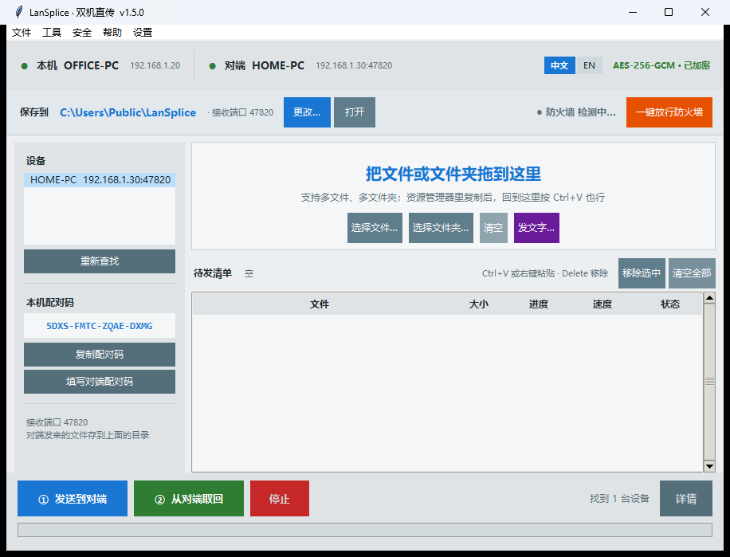
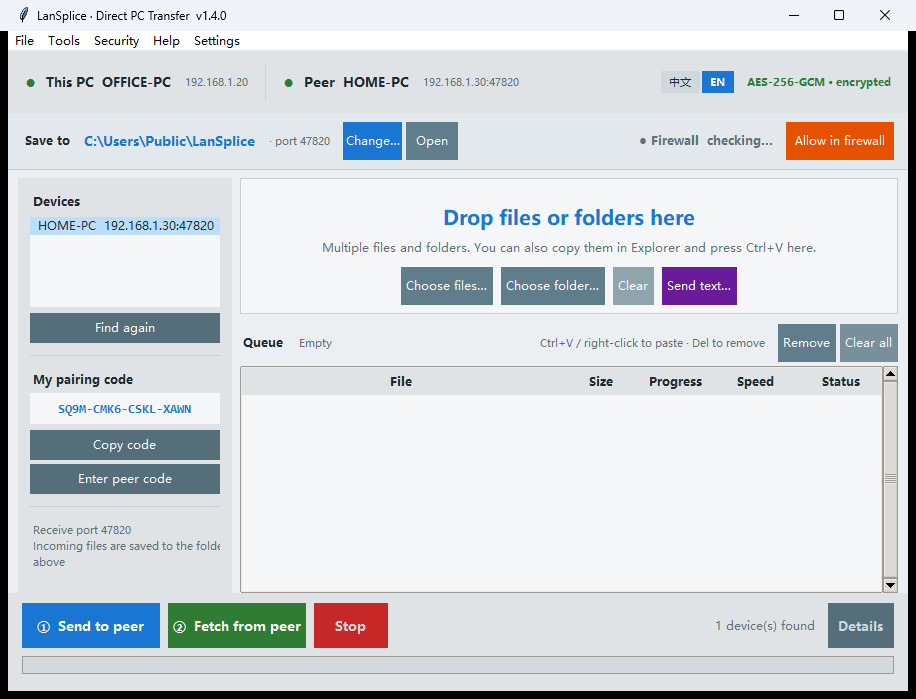

# LanSplice · 双机直传

**简体中文** ｜ [English](README.en.md)

两台 Windows 电脑在同一个局域网里，把文件或文件夹直接推到对方硬盘上。
**不走网盘，不开 Windows 共享，不插 U 盘。** 界面中英双语，首页一键切换。

传一半断了能接着传；对端已有同名文件不会被覆盖；剪贴板里的文字可以一键推过去；
手机扫个码就能用浏览器收发；关窗口只是缩到托盘，接收不中断。



**[⬇ 下载 LanSplice.exe](https://github.com/podcatcher962/LanSplice/releases/latest)** —
单文件 16 MB，免安装，32 位 / 64 位 Windows 通用。

作者：© 永远的兰兰

---

## 运行环境

| 系统 | 支持情况 |
|---|---|
| **Windows 11**（64 位） | ✅ 支持 |
| **Windows 10**（32 位 / 64 位） | ✅ 支持，主要开发和测试环境 |
| Windows 8.1 | ⚠️ 大概率能跑，未实测 |
| Windows 7 及更早 | ❌ 不支持 |

**只有一个文件，不用挑：`LanSplice-v1.4.0.exe`。**

它是 32 位程序。64 位 Windows 自带兼容层（WoW64），双击就直接跑，
跟普通程序没区别，任务管理器里会显示「32 位」——这是正常的。
所以**你不需要知道自己电脑是多少位**，32 位系统、64 位系统都用这一个。

为什么最后合成一个包：

| 对比 | 32 位包（现在发的） | 64 位包 |
|---|---|---|
| 32 位 Windows | ✅ 能跑 | ❌ 跑不了 |
| 64 位 Windows | ✅ 能跑 | ✅ 能跑 |
| 本机回环实测 | 126 MB/s | 186 MB/s |
| 千兆网线实测 | ≈ 87 MB/s（跑满） | ≈ 87 MB/s（跑满） |
| 峰值内存 | 25 MB | 31 MB |

千兆网的理论上限约 118 MB/s，实际能到 87 MB/s 左右，两个包都卡在网线上，
**用起来完全一样**。少一个文件，就不会有人拿错。

唯一的取舍：哪天换成 2.5G / 10G 网，32 位包会先到瓶颈（约 126 MB/s）。
真要那种环境再找作者要 64 位原生版。

**为什么最低到 Win10：** 打包用的是 Python 3.12 / 3.9，官方最低要求 Windows 8.1，
Win7 缺必要的系统接口，强行打包也起不来。另外 Win7 早已停止安全更新，
在它上面跑一个要开网络端口的程序本身就不合适。

---

## 它解决什么问题

| | U 盘 | 网盘 | **LanSplice** |
|---|---|---|---|
| 8.93 GB 实测耗时 | 2~5 分钟 + 来回跑腿 | 35~45 分钟 | **约 2 分钟** |
| 是否需要动手 | 拔插、走动、复制 | 拖上传、等下载、解压 | 拖进去、点一下 |
| 增量（只传新的） | 得自己挑 | 得自己挑 | **自动跳过同版本** |
| 数据经过第三方 | 不经过，但盘会带毒 | **经过** | 不经过 |
| 传输加密 | 无 | 由平台决定 | **AES-256-GCM** |
| 依赖外网 | 否 | 是 | 否 |

千兆有线实测 **87 MB/s**（AES-256-GCM 全帧加密后），约合 700 Mbps，
瓶颈通常在硬盘读速而不是网络。

---

## 双语界面

首页右上角有 **「中文」/「EN」** 两个小键，点一下立即换语言，不用重启。

- 切换时**待发清单、设备列表、已选对端都保留**，不会丢
- 选择记在配置里，下次打开还是这个语言
- 第一次运行时自动跟随系统：中文 Windows 用中文，其他用英文
- 传输过程中不允许切换（按钮会提示先停止），避免进度数字和状态文字串在一起

英文模式下窗口标题是 `LanSplice · Direct PC Transfer`，菜单、对话框、帮助、
诊断输出、日志全部是英文，没有半中半英。



---

## 用法

### 第一次（两台各做一次）

1. 两台都双击 `LanSplice.exe`。

   **首次运行会弹出「Windows 安全中心」问是否允许联网 —— 点「允许」。**
   然后顺手做一步：首页第二行右侧点「一键放行防火墙」，在 UAC 窗口点「是」。
   这一步会把系统自动建的宽松规则换成严格规则（只对内网段、只对本程序），
   以后开机不再弹窗，也不用担心带出门时端口敞开。
   做完那盏灯会变绿并显示「防火墙 已放行」。

   > 为什么必须做、以及为什么这样做绝不会把电脑暴露到公网，见下面
   > [「防火墙这件事」](#防火墙这件事) 一节 —— 这是本软件唯一需要管理员权限的地方，
   > 值得花两分钟看明白。

2. 左边会显示一串**配对码**，形如 `K7QM-9XRA-2LFD-T8EW`。
3. 点「复制配对码」，到另一台点「填写对端配对码」粘进去。
   —— 反过来做也行，两台最终是同一串码就行。
4. 点「工具 → 重新查找设备」，列表里选中对端。

找不到对端时：先确认两台软件都开着；再看首页那盏防火墙灯是不是绿的。

### 每次传文件

1. 把文件或文件夹**拖进虚线框**（也可以点「选择文件…」「选择文件夹…」，都支持多选）。
   还有一个更顺手的：在资源管理器里 `Ctrl+C` 复制，回到窗口按 `Ctrl+V`，直接进清单 ——
   复制了几个就粘几个，重复的会自动跳过。**在清单上点右键**也有「粘贴」，
   外加「添加文件… / 添加文件夹… / 移除选中 / 清空全部」。
2. 点「① 发送到对端」。
3. 看进度条走完。右下角会写明**发到哪台机的哪个目录、发了多少、用了多久、平均多快**，
   点旁边的「详情」能看到完整清单和对端存放位置。

   详情窗口里点 **「在对端打开文件夹」**，对端电脑上会直接弹出资源管理器、
   停在接收目录上，不用再走过去找。走的是同一根加密通道，不需要开共享、不用输账号密码。
   （这一条要求两台都是 v1.2.2 以上；版本旧的一台收不到这个请求。）

文件落到对端的**接收目录**（默认 `E:\_xfer`），目录结构原样保留。
首页「保存到」一行可以直接「更改…」接收目录，或「打开」去看收到的东西。

同名且大小、修改时间都一致的文件会被自动跳过，不会重传。

**传完的条目会自动从清单里移走**，失败或取消的会留着，方便直接重发。
清单支持 Ctrl / Shift 多选，按 `Delete` 或点「移除选中」只删选中的那几项；
「清空全部」才是全部清空。双击条目可在资源管理器里定位。

---

## 防火墙这件事

这一节是给"我不想为了传个文件把电脑搞出个窟窿"的人看的。

### 为什么需要放行

Windows 防火墙的默认策略是：**从外面进来的连接一律挡掉**。这是好事，但它分不清
"别人来偷东西"和"隔壁你的另一台电脑要给你送文件"。

LanSplice 干的两件事都是**入站**：

| 端口 | 用途 | 方向 |
|---|---|---|
| TCP 47820 | 对方连进来传文件 | 入站 |
| UDP 47821 | 广播找设备（"我在"、"你在吗"） | 入站 |

不放行会发生什么：对方点了「查找设备」看不到你；就算手填了 IP，连接也会超时。
**最常见的情况是两台在同一网段、网络也通，就是连不上 —— 十次有九次是这一条。**

请注意：**放行 ≠ 关防火墙**。防火墙照常工作，只是给这一个程序的这两个端口开一道门，
门口还站着岗（只认内网来源，见下）。

### 点「一键放行防火墙」到底改了什么

程序会弹一次管理员授权，然后做四件事：

1. **删掉** Windows 第一次运行时自动建的那条宽松规则
   （那条规则对任何来源、任何程序都放行，这才是真正该担心的东西）
2. 重建 **两条** 规则，都只针对本程序：
   - `LanSplice-TCP`：TCP 47820，**仅入站**
   - `LanSplice-UDP`：UDP 47821，**仅入站**
3. 每条规则都带三个限制：
   - **程序**：只认 `LanSplice.exe` 这一个文件 —— 本机其他软件借不到这两个端口
   - **来源地址**：只认 `192.168.0.0/16`、`10.0.0.0/8`、`172.16.0.0/12`
     这三段私有地址，外加 `127.0.0.1`（本机自测）
   - **方向**：只有入站，出站规则一条没动
4. 把已经开着的接收端口重建一次，让新规则立即生效（不用关程序重开）

### 为什么这绝不会把电脑开放到公网

按层说，每一层单独拿出来都足够：

| 层 | 拦的是什么 |
|---|---|
| Windows 防火墙 | 数据包来源不是内网段（192.168/10/172.16-31）就**直接丢掉**，程序连包都收不到。公网 IP 全部在这一层出局 |
| 规则范围 | 只针对 `LanSplice.exe` 这个文件；端口不对本机其他程序开放 |
| 端口数量 | 只有两个，且都是入站。没有 Web 服务、没有远程桌面、没有文件共享 |
| 软件行为 | 程序**不主动连外网**，不做 UPnP、不做端口映射、不往路由器上打洞，不会自己给自己开门 |
| 路由器 | 家用路由器默认 NAT：外网无法主动连到内网任何一台机器，除非你自己在路由器上做端口转发 |
| 加密层 | 就算局域网里有人扫到 47820，还要过 X25519 + 配对码 HMAC 握手；没配对码，一个字节也传不进来 |

换句话说：**它开的是一道只许家里人走的门，门外还挂着锁。** 公网上的人既找不到门，
找到了也进不来。

### 自己验证一下（可选）

在 PowerShell 里跑：

```powershell
Get-NetFirewallRule -DisplayName 'LanSplice-*' | Get-NetFirewallAddressFilter
Get-NetFirewallRule -DisplayName 'LanSplice-*' | Get-NetFirewallApplicationFilter
```

第一条看 `RemoteAddress`：应该只有三段内网 + 127.0.0.1，看不到 `Any`。
第二条看 `Program`：应该只有你那个 `LanSplice.exe` 的完整路径。

程序里也有：**「工具 → 安全检查」**，会把规则名、启用状态、作用域列出来。

### 什么时候需要重新放行一次

- 换了 exe 的位置（改名、移动文件夹、解压到别处）—— 规则里记的是程序完整路径，对不上就不生效
- 换了新版本、放在新目录
- 用「一键放行防火墙」时在 UAC 窗口点了「否」

重新点一次就行，程序会自动删旧规则再建新的，不会越堆越多。

---

## 安全设计

这套东西不需要开 Windows 文件共享，**445 端口全程不碰**。

| 环节 | 做法 |
|---|---|
| 发现设备 | UDP 广播，只回主机名和端口，**不含任何密钥** |
| 身份认证 | 配对码派生密钥 + X25519 密钥交换 + 双向 HMAC |
| 通道加密 | AES-256-GCM，收发各一把独立密钥，序号做 nonce 防重放 |
| 来源限制 | 只接受内网 IPv4 段，公网 IPv4 / IPv6 一律拒绝 |
| 防火墙 | 两条入站规则，限定程序 + 内网来源（见上一节） |
| 写入范围 | 只能落在接收目录内；`..`、盘符、`CON`/`NUL` 等保留名全部拦截 |
| 远程打开目录 | 只允许打开接收目录及其子目录，越界（`..`、盘符、根目录之外）一律拒绝，且根目录不存在时拒绝打开任何东西 |
| 半成品 | 先写 `.l2ptmp`，字节数校验通过才改名，中途失败不留垃圾 |

**配对码就是密码**，别发群里、别截图外传。泄露了到「安全 → 重新生成本机配对码」换一个。

对端发来的 `.exe` / `.bat` / `.lnk` 别直接双击 —— 这条规矩跟用 U 盘时一样。
本软件不做病毒扫描。

---

## 关于 IP 地址

**不用管。** 软件用 UDP 广播自动找设备，路由器把 IP 换成什么都能找到。

只有一种情况需要手动填：路由器开了"AP 隔离/访客隔离"，广播出不去。
这时用「工具 → 手动填写对端地址」，填对方的 IPv4 和端口（`192.168.1.20:47820`）。

想固定地址也不用改软件 —— 在路由器后台做「DHCP 静态地址绑定」，把两台机器的
MAC 和 IP 绑死即可，比在 Windows 里设静态 IP 更省事，也更不容易出错。

---

## 常见问题

**找不到对端？**
两台都要开着软件；防火墙要放行过；确认连的是同一个路由器（不是访客网络）。

**必须对端先打开，我这边才看得见吗？**
v1.1.3 及更早是这样：对端只会"应答"，不会"打招呼"，
所以先开的那台永远看不见后开的那台，得自己重开一次或点「重新查找」。
v1.1.4 起，接收端每 8 秒主动广播一次"我在"，对面收到就自动加进设备列表。
**谁先开都行**，后开的那台最多 8 秒就会自动出现，不用点任何按钮。

> 注意：自动发现要两台都是 v1.1.4 以上。一台新一台旧时，
> 新的那台能收到旧的查找请求并应答，但旧的不会主动广播。

**放行了防火墙，还是连不上，得关掉程序重开才行？**
v1.1.2 及更早就是这样。Windows 改完防火墙规则（或把网络类别从"公用"
改成"专用"）之后，**已经在监听的那个端口不会自动套用新规则**，
必须重新监听一次。v1.1.3 起，「放行防火墙」做完会自动重建接收端
（约 0.4 秒），不用再手动关程序。

**开两个窗口会怎样？**
后开的那个绑不上端口，会在状态栏提示"端口被占用，2 秒后自动重试"，
重试 3 次还不行就弹窗提醒你关掉多余的窗口。

**速度很慢，只有 7~10 MB/s？**
先确认两边都是网线（Wi-Fi 会掉到 10 MB/s 以下）。
如果是有线还这么慢，看两边版本号是否都是 v1.1.2 以上 ——
v1.1.1 及更早没开 `TCP_NODELAY`，Nagle 和 Windows 的延迟 ACK
会互相等待，把千兆压到 7 MB/s。v1.1.2 修好后是 87 MB/s。

**能不能直接在对端电脑上打开文件夹看收到的东西？**
能，但要两台都是 v1.2.2 以上：传完点「详情」→「在对端打开文件夹」，
对端屏幕上会弹出资源管理器并停在接收目录。对端没开软件或版本太旧会提示。

注意这是**让对端自己打开**，不是在你这台机器上浏览对端的磁盘 ——
本机横向浏览对端文件需要 Windows 文件共享，那正是这个软件刻意避开的。

**能不能跨公网用？**
不能，也不打算做。这个软件只服务"同一个路由器下的两台自有设备"。
（这也是它安全的原因：公网根本到不了。）

**设备列表里怎么多出一台 `127.0.0.1`？**
v1.2.5 已修。原因是广播副本回到本机时源地址可能是回环地址，旧版只比网卡地址，
把自己的包当成了对端。现在回环地址一律算自己，宣告里还带实例号做二次识别。

**config 在哪？**
`%APPDATA%\LanSplice\config.json`，存配对码、接收目录、端口、语言。
从旧名 Link2PC 升级时，第一次运行会自动把旧目录的配置搬过来。

**端口被占用？**
默认 TCP 47820 / UDP 47821。改端口要两台一致。

---

## 免责声明

仅供同一局域网内的自有设备之间传输文件。请勿用于传输违法内容。
作者不对使用本软件造成的任何数据损失或法律后果负责。

---

## 技术栈

Python 3.12 + tkinter + tkinterdnd2 + cryptography，PyInstaller 单文件打包
（32 位环境用 Python 3.9 打包，一个 exe 通吃 32/64 位 Windows）。

- `link2pc_core.py` — 协议、加密、传输、发现
- `link2pc_gui.py` — 界面
- `link2pc_i18n.py` — 中英文案表
- `BAT方案-备用/` — 早期基于 Windows 共享的脚本方案，仅作备份，日常用不到

> 源码文件名仍带 `link2pc` 前缀：模块名一改，所有 import、打包脚本、测试都要跟着动，
> 而用户看不到这些文件名。产品名只出现在界面、配置目录和防火墙规则里。

**自己编译**（三个 py 放在同一目录）：

```bash
pip install cryptography tkinterdnd2 pyinstaller
pyinstaller -F -w --name LanSplice \
  --collect-all tkinterdnd2 --icon app.ico link2pc_gui.py
```

用 32 位 Python 编译出来的 exe 在 32/64 位 Windows 上都能跑。

---

## 更新记录

**v1.4.0** — 断点续传、不覆盖、文字互传、手机网页端、托盘常驻
- **断点续传**：以前断线就从头再来，8.9 GB 传一半断掉等于白传。现在按 16 MB
  分段保存，再点一次「发送」自动从断点接着传，界面上显示「续传 2.1 GB」
- **同名不覆盖**：以前接收端直接 `os.replace`，对端有同名文件会被无声顶掉。
  现在自动存成 `素材 (2).mp4`，并在结果里说明存成了什么名字
- **完整性校验**：边传边按段算 SHA-256，逐段对账，出问题能指出坏在第几段；
  另加可选的「传完再校验文件」，两端各完整读一遍比对，能查出读盘/写盘层面的错误
- **文字/剪贴板互传**：Ctrl+Shift+V 把本机剪贴板直接推到对端，对端点一下就能粘；
  对端发来的文字默认弹窗，不自动劫持剪贴板
- **手机网页端**：文件 → 手机传文件，界面显示二维码，手机浏览器扫码即可上传下载，
  不用装 APK、不用数据线
- **托盘常驻**：关窗口缩到托盘，接收不中断；托盘右键可启停接收、开关开机自启、
  退出；传完弹气泡 + 提示音
- **记住上次设备**：启动时自动重连上次那台，不用每次重新扫描
- 协议加了能力协商，v1.4 与 v1.3 之间可以互相连（对端是旧版时自动退回老流程）
- 帮助改成可滚动、可复制；设置菜单新增通知 / 音效 / 托盘 / 自启等开关
- 自动化检查从 266 项增加到 **329 项**，新增协议层（续传、改名、校验、旧版兼容）
  与手机网页端（口令、路径穿越、上传下载边界）两部分

**v1.3.3** — 英文界面按钮不再被截断
- 英文比中文长，几个按钮（Choose files… / Choose folder… / Remove）写死了字符宽度，
  显示出来被截成 `move select`、`Choose folder.` 这样。改成按文字自然宽度撑开
- 「Remove selected」收短为「Remove」，队列标题行的英文提示同步收短，右侧不再挤在一起
- 顺带修两处只在开发者这边出现的问题：`PeerServer._handle` 与 Python 3.13 里
  `Thread._handle` 同名，会被覆盖成线程句柄，源码版在 3.13 下收到连接就崩；
  打包脚本现在显式带上 OpenSSL 的两个 DLL，`--clean` 重建也不会漏
- 新增中英文界面截图、开发历程文档

**v1.3.2** — 修「一键放行」弹出的那行红字
- 现象：点「一键放行防火墙」后，会弹出一行
  `Continue='SilentlyContinue' : 无法将…识别为 cmdlet`，看着像失败，其实规则建上了
- 原因：提权时把脚本塞进了外层 PowerShell 的**双引号字符串**里，外层先做了一次变量展开，
  `$ErrorActionPreference` 变成它的当前值 `Continue`、`$_` 变成空，内层脚本被改坏
- 改法：脚本改用 `-EncodedCommand`（base64）传进去，外层怎么解析都动不到它；
  提权窗口同时隐藏，不再闪一下黑框
- 顺带修：英文界面里防火墙说明的换行显示成了 `/n/n`
- 若之前点过放行，旧规则里的程序路径可能带双反斜杠（`E:\\...\\LanSplice.exe`），
  新版本点一次放行会先清掉再按正确路径重建

**v1.3.1** — 合成一个包 + 修 32 位版握手失败
- 只发一个 `LanSplice-v1.3.1.exe`（32 位构建），32 位和 64 位 Windows 都能直接用，
  不用再让用户去分辨自己的系统位数
- **修一个严重问题**：v1.3.0 的 32 位包能打开窗口，但握手阶段直接断开，
  根本传不了文件。原因是 32 位环境里的加密库是 3.6 版本，
  取公钥用的 `public_bytes_raw()` 要 4.0 以上才有；改成新旧版本都支持的写法
- 验收方式也补上了：不再只检查「窗口能开」，而是让 exe 真正收一个 24 MB 文件、
  校验哈希一致

**v1.3.0** — 改名 LanSplice + 中英双语 + 32 位版本
- 软件名从 `Link2PC` 改为 **LanSplice**。旧名有冲突：韩国 Jeio Tech 有现成软件叫
  `LC Link2PC`，AOL 2006 年也用过这个名字，搜索结果会被别人的东西压住
- 中英双语：首页右上角「中文 / EN」一键切换，切换时清单和设备列表都保留，
  选择记进配置；首次运行跟随系统语言
- 新增 **32 位（x86）** 安装包，老机器也能用；两台位数不同也能互传
- 防火墙规则再加一层收敛：`-Program` 只放行本程序，本机其他软件借不到这两个端口
- 配置目录改为 `%APPDATA%\LanSplice`，首次运行自动从旧目录迁过来（配对码不丢）
- 防火墙/放行说明重写：为什么需要、具体改了什么、为什么不会开到公网、怎么自查

**v1.2.5** — 清单右键菜单 + 修「127.0.0.1」幽灵设备
- 待发清单里点右键：粘贴 / 添加文件 / 添加文件夹 / 移除选中 / 清空全部，
  点到哪一行就选中哪一行，传输中会自动置灰
- 修：设备列表有时会多出一台 `127.0.0.1:47820` 的「自己」。
  原因是给 `255.255.255.255` 发广播时，Windows 会把副本回送给本机 socket，
  某些网卡组合下源地址显示成回环地址，而以前只拿网卡地址判断「是不是自己」，
  于是自己的包被当成对端收进了列表
- 现在两道保险：回环 / 本机网卡地址一律算自己；宣告里再带一个本机实例号，
  认得出的自己的包直接丢弃（对端是 v1.2.5 以下时靠第一道）
- 顺带：同一台机器的多条应答按主机名合并时忽略大小写，`PC-A` 和 `pc-a` 不会再算两台

**v1.2.4** — 待发清单支持 Ctrl+V 粘贴
- 在资源管理器里复制文件/文件夹，回到 LanSplice 按 `Ctrl+V` 直接进清单，不用拖、不用点
- 复制的若只是普通文字（比如一段话），这个键仍归输入框用，不会被抢
- 已经在清单里的会自动跳过，并告诉你「这 N 项已经在清单里」
- 传输过程中按 Ctrl+V 只提示先停止，不会改动清单

**v1.2.3** — 修详情窗口按钮被窗口下沿切掉一半
- 原因：正文用 `expand` 先占了整块空间，底部按钮栏后放，被挤到窗口外，
  只露出半截（1366×768 / 高 DPI 缩放的机器上明显）
- 改为按钮栏先占底部、正文再撑满；窗口尺寸按屏幕自适应，最小 560×340
- 按钮不再写死字符宽度（中文按钮会贴边被截），改按文字自然宽度
- 新增回归断言：三个按钮都必须完整落在窗口内、宽度能放下文字，压到 560×340 也要成立

**v1.2.2** — 传完能直接在对端打开文件夹
- 结果「详情」窗口新增「在对端打开文件夹」：点了之后对端电脑自动弹出资源管理器，
  停在接收目录（加密通道内的一个指令，不开共享、不要账号密码）
- 该动作只允许打开接收目录及其子目录：`..`、盘符、越界路径在服务端就被拒；
  接收目录本身不存在时干脆不打开，避免误开配置之外的目录
- 目录被改名/删掉时自动退到最近还存在的上级（不越过接收目录）
- 对端没开软件、或版本低于 v1.2.2，会给出明确提示而不是静默失败

**v1.2.1** — 界面按实际使用习惯重排
- 首页第二行新增「保存到」与「一键放行防火墙」，这两个上手关键步骤不用再翻菜单
- 防火墙状态灯自动检测（绿色已放行 / 红色未放行），点灯可手动复查
- 待发清单支持 Ctrl / Shift 多选，「移除选中」「清空全部」分开
- 传输结束自动移走已成功的条目，失败/取消的保留以便重发
- 右下角写明发到哪台机的哪个目录、大小、耗时、平均速度；新增「详情」查看完整清单
- 修正清单里进度/速度/状态列一直不更新的问题
- 对端上报的接收目录统一成 Windows 反斜杠显示（`E:/x` → `E:\x`）
- 窗口默认 900×640（外框 916×699），1366×768 的笔记本也能完整显示

**v1.1.5** — 自动发现后对端栏仍是红色「未连接」、同名设备重复两行

**v1.1.4** — 接收端每 8 秒主动广播，谁先开都能自动发现

**v1.1.3** — 放行防火墙后自动重启接收端，不用再关程序重开

**v1.1.2** — 开启 `TCP_NODELAY`，千兆从 7 MB/s 恢复到 87 MB/s

**v1.1.1** — 多网卡广播、公用网络放行、连接诊断

**v1.1.0** — 首个可用版本
