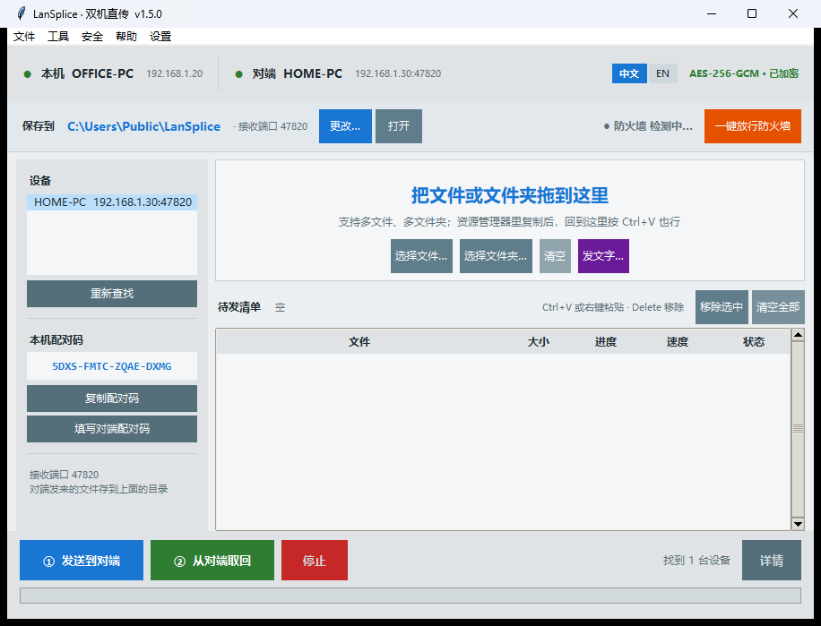
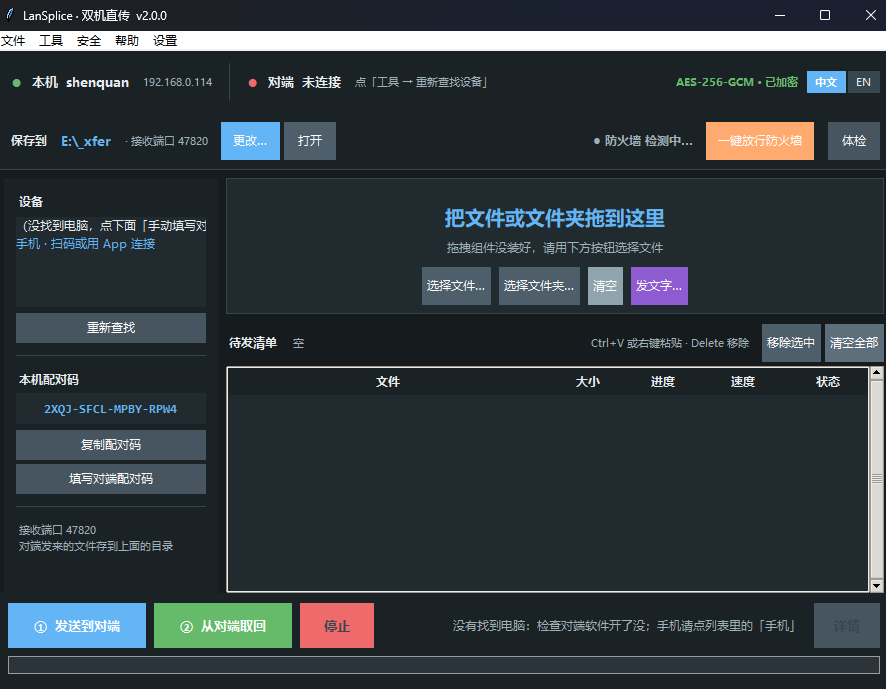
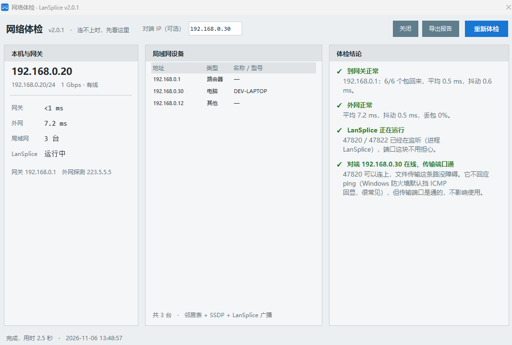
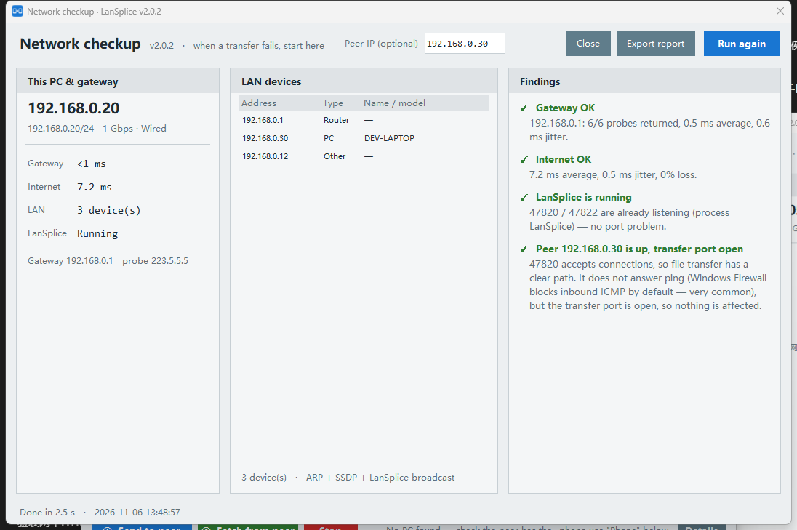
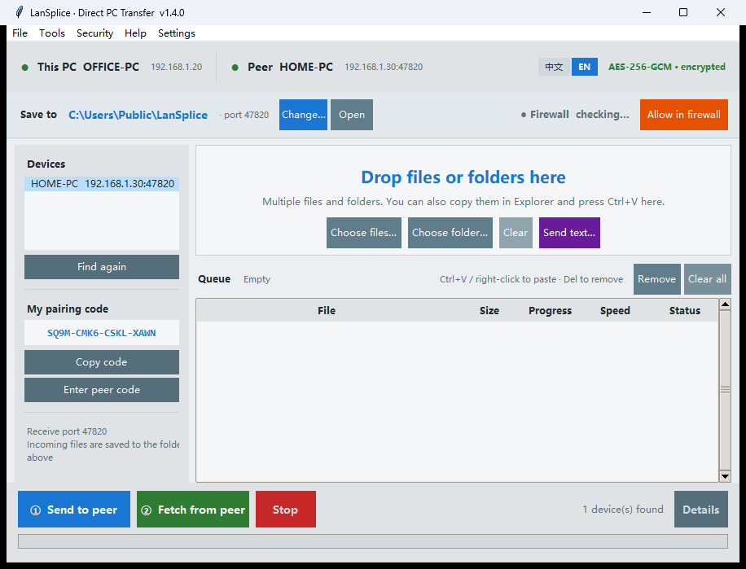
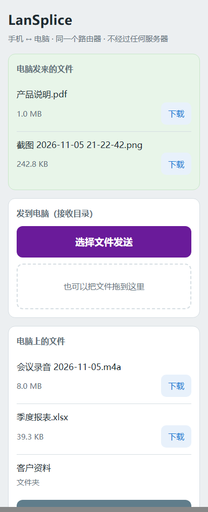

# LanSplice · 双机直传

**简体中文** ｜ [English](README.md)

连接同一个路由器、同网段的两台电脑，可以直接推送文件、文件夹、文字到对端，也能直接和对端聊天。
没有主从之分，不经过任何服务器。

不用开 Windows 共享，不用 U 盘。Windows 双击就能跑，不用装 Python。
统信 UOS 20 在真机上跑通过；麒麟、Deepin、Ubuntu 用同一套离线包，断网也能装。

第一次用就五步：两台电脑都打开软件，把一台的配对码填到另一台，点左边的「重新查找」，
把文件拖进虚线框，点左下角「① 发送到对端」。找不到对方电脑，点右下角「一键放行防火墙」。

传一半断了可以接着传，对端有同名文件不会覆盖。关掉窗口只是缩到托盘，接收不中断。



默认就是浅色。想换深色走「工具 → 深浅色」（浅色 / 深色 / 跟随系统）。电脑端、手机网页端、安卓端三处都支持，
换色时正在传的文件不会断：



连不上的时候，快捷条最右边的「体检」会告诉你卡在哪一层：本机网卡、网关、外网、
端口占用、对端是否在线。左侧是证据，右侧直接给结论和该动的地方：



切成英文之后，这个窗口里的每一条结论、以及导出的 HTML 报告，整篇都是英文：



**[⬇ 下载 LanSplice.exe](https://github.com/podcatcher962/LanSplice/releases/latest)** —
单文件 13.8 MB，免安装，32 位 / 64 位 Windows 通用。

手机也想收？装一个 **53 KB 的安卓 App**：`LanSplice-1.9.2.apk`（同一个下载页），
不用数据线、不用网盘，在相册里点「分享」选它，照片就直接落到电脑的接收目录。

作者：© 永远的兰兰

---

## 运行环境

| 系统 | 支持情况 |
|---|---|
| **Windows 11**（64 位） | ✅ 支持 |
| **Windows 10**（32 位 / 64 位） | ✅ 支持，主要开发和测试环境 |
| Windows 8.1 | ⚠️ 大概率能跑，未实测 |
| Windows 7 及更早 | ❌ 不支持 |
| **统信 UOS / 银河麒麟 V10 / Deepin / Ubuntu** | ✅ 支持（图形界面 + 命令行），见 [docs/linux.md](docs/linux.md) |
| 飞腾 / 鲲鹏 / 龙芯 | ⚠️ 协议与架构无关，但**尚未在真机上验证** |
| macOS（Intel / Apple Silicon） | ⚠️ 有原生版，**但未在真机 Mac 上验证**：源码可直接跑，也可用 `build_macos.sh` 打成 `.app`；见 [docs/macos.md](docs/macos.md)（还没 Mac？用浏览器方式：[docs/mac-now.md](docs/mac-now.md)） |

**Windows 只有一个文件，不用挑：`LanSplice-v2.0.3.exe`。**

它是 32 位程序。64 位 Windows 自带兼容层（WoW64），双击就直接跑，
跟普通程序没区别，任务管理器里会显示「32 位」——这是正常的。
所以**你不需要知道自己电脑是多少位**，32 位系统、64 位系统都用这一个。

为什么最后合成一个包：

| 对比 | 32 位包（现在发的） | 64 位包 |
|---|---|---|
| 32 位 Windows | ✅ 能跑 | ❌ 跑不了 |
| 64 位 Windows | ✅ 能跑 | ✅ 能跑 |
| 本机回环实测 | 126 MB/s | 186 MB/s |
| 千兆网线实测 | ≈ 87 MB/s（跑满） | ≈ 87 MB/s（跑满） |
| 峰值内存 | 25 MB | 31 MB |

千兆网的理论上限约 118 MB/s，实际能到 87 MB/s 左右，两个包都卡在网线上，
**用起来完全一样**。少一个文件，就不会有人拿错。

唯一的取舍：哪天换成 2.5G / 10G 网，32 位包会先到瓶颈（约 126 MB/s）。
真要那种环境再找作者要 64 位原生版。

**为什么最低到 Win10：** 打包用的是 Python 3.12 / 3.9，官方最低要求 Windows 8.1，
Win7 缺必要的系统接口，强行打包也起不来。另外 Win7 早已停止安全更新，
在它上面跑一个要开网络端口的程序本身就不合适。

---

## 它解决什么问题

| | U 盘 | 网盘 | **LanSplice** |
|---|---|---|---|
| 8.93 GB 实测耗时 | 2~5 分钟 + 来回跑腿 | 35~45 分钟 | **约 2 分钟** |
| 是否需要动手 | 拔插、走动、复制 | 拖上传、等下载、解压 | 拖进去、点一下 |
| 增量（只传新的） | 得自己挑 | 得自己挑 | **自动跳过同版本** |
| 数据经过第三方 | 不经过，但盘会带毒 | **经过** | 不经过 |
| 传输加密 | 无 | 由平台决定 | **AES-256-GCM** |
| 依赖外网 | 否 | 是 | 否 |

千兆有线实测 **87 MB/s**（AES-256-GCM 全帧加密后），约合 700 Mbps，
瓶颈通常在硬盘读速而不是网络。

---

## 双语界面

首页右上角有 **「中文」/「EN」** 两个小键，点一下立即换语言，不用重启。

- 切换时**待发清单、设备列表、已选对端都保留**，不会丢
- 选择记在配置里，下次打开还是这个语言
- 第一次运行时自动跟随系统：中文 Windows 用中文，其他用英文
- 传输过程中不允许切换（按钮会提示先停止），避免进度数字和状态文字串在一起

英文模式下窗口标题是 `LanSplice · Direct PC Transfer`，菜单、对话框、帮助、
诊断输出、日志全部是英文，没有半中半英。



---

## 用法

### 第一次（两台各做一次）

1. 两台都双击 `LanSplice.exe`。

   **首次运行会弹出「Windows 安全中心」问是否允许联网 —— 点「允许」。**
   然后顺手做一步：首页第二行右侧点「一键放行防火墙」，在 UAC 窗口点「是」。
   这一步会把系统自动建的宽松规则换成严格规则（只放这两个端口、只对内网段），
   以后开机不再弹窗，也不用担心带出门时端口敞开。
   做完那盏灯会变绿并显示「防火墙 已放行」。

   > 为什么必须做、以及为什么这样做绝不会把电脑暴露到公网，见下面
   > [「防火墙这件事」](#防火墙这件事) 一节 —— 这是本软件唯一需要管理员权限的地方，
   > 值得花两分钟看明白。

2. 左边会显示一串**配对码**，形如 `K7QM-9XRA-2LFD-T8EW`。
3. 点「复制配对码」，到另一台点「填写对端配对码」粘进去。
   —— 反过来做也行，两台最终是同一串码就行。
4. 点「工具 → 重新查找设备」，列表里选中对端。

找不到对端时：先确认两台软件都开着；再看首页那盏防火墙灯是不是绿的。

### 每次传文件

1. 把文件或文件夹**拖进虚线框**（也可以点「选择文件…」「选择文件夹…」，都支持多选）。
   还有一个更顺手的：在资源管理器里 `Ctrl+C` 复制，回到窗口按 `Ctrl+V`，直接进清单 ——
   复制了几个就粘几个，重复的会自动跳过。**在清单上点右键**也有「粘贴」，
   外加「添加文件… / 添加文件夹… / 移除选中 / 清空全部」。
2. 点「① 发送到对端」。
3. 看进度条走完。右下角会写明**发到哪台机的哪个目录、发了多少、用了多久、平均多快**，
   点旁边的「详情」能看到完整清单和对端存放位置。

   详情窗口里点 **「在对端打开文件夹」**，对端电脑上会直接弹出资源管理器、
   停在接收目录上，不用再走过去找。走的是同一根加密通道，不需要开共享、不用输账号密码。
   （这一条要求两台都是 v1.2.2 以上；版本旧的一台收不到这个请求。）

文件落到对端的**接收目录**（默认 `E:\_xfer`），目录结构原样保留。
首页「保存到」一行可以直接「更改…」接收目录，或「打开」去看收到的东西。

同名且大小、修改时间都一致的文件会被自动跳过，不会重传。

**传完的条目会自动从清单里移走**，失败或取消的会留着，方便直接重发。
清单支持 Ctrl / Shift 多选，按 `Delete` 或点「移除选中」只删选中的那几项；
「清空全部」才是全部清空。双击条目可在资源管理器里定位。

---

## 文件夹镜像

上面那些都是「这次我想传这几个东西」。如果你要的是「这两个目录长期保持一致」，
用 **工具 → 镜像文件夹…**：

1. 左边选本机目录，右边填对端目录（**对端机器上的绝对路径**）。
2. 点「开始镜像」。

规则只有一句：**只补新增和改过的文件**。

- 本机有、对端没有 → 传
- 本机改过（大小或修改时间不同）→ 覆盖对端那一份
- 本机没变 → 跳过，不白跑带宽
- 对端多出来的文件 → **不删**。镜像永远只做加法，删文件请自己动手

进度条下面会实时写「检查完 1,234 个文件，需要传 17 个，共 2.1 GB」——
先算清楚再动手，不是闷头一个个试。

改动过的文件在镜像里**按原名覆盖**。这一点和普通发送故意不同：普通发送永远另存为
`xxx (2).ext`（绝不顶掉对端已有的东西），而镜像的语义就是「让两边一样」，
再改名会在对端堆出一串 `(2)`、`(3)`、`(4)`。

---

## 自动同步

镜像是「点一次做一次」。要的是「这个文件夹一直跟着走」，用 **工具 → 自动同步…**：

1. 点「添加…」，选本机一个文件夹，再填对端接收目录下的子目录名（留空就用文件夹名）。
2. 程序开着就行，不用再管。

规则和镜像一样只做加法，另加两条：

- 本地删掉的文件，对端那份**不删**。删除不可逆，而多一份备份几乎从来不是坏事
- 正在写入的文件**不会传**。要连续两轮扫描（间隔 6 秒）都看到大小和修改时间没变才动手，
  所以刚存下的文件会晚几秒过去 —— 换来的是不会传出半截文件

状态列会写「已同步 12 个（3.4 MB）」。关掉窗口不影响同步；不想同步了就取消勾选
「开着程序就同步」。还没选对端设备时任务不会报错刷屏，只是等你在左边选一台。

---

## 命令行

同一个 exe 也能直接跑命令，方便写进批处理、计划任务，或者被别的脚本调用。

```bat
:: 发一个文件
LanSplice.exe send "D:\视频\样片.mp4" --to 192.168.1.20

:: 发整个目录（对端保留目录结构）
LanSplice.exe send "D:\素材" --to 192.168.1.20

:: 通配符
LanSplice.exe send "D:\日志\*.log" --to 192.168.1.20

:: 扫一遍局域网，看谁开着 LanSplice
LanSplice.exe devices

:: 当接收端（不打开界面，只等着收）
LanSplice.exe serve --root "D:\收件箱"

:: 看版本
LanSplice.exe version
```

| 参数 | 说明 |
|---|---|
| `--to ip[:port]` | 对端地址，必填。端口默认 `47820`，不写就用默认 |
| `--code XXXX-XXXX-XXXX-XXXX` | 配对码，不填就用本机配置里存的那个 |
| `--overwrite` | 对端有同名文件直接覆盖（默认另存为 `xxx (2).ext`） |
| `--verify` | 传完再完整校验一遍（慢，但能查出读盘、写盘层面的错误） |

`send` 会打印每个文件的进度条，最后汇总发了几个、跳过几个、用了多久。

**退出码有三档** —— 计划任务和批处理靠这个判断该不该重跑：

| 退出码 | 含义 | 该做什么 |
|---|---|---|
| `0` | 全部成功（含「对端已有、跳过」） | 没事 |
| `1` | 传了一部分，有文件失败 | 值得重跑，断点会接上 |
| `2` | 一个都没开始：连不上对端，或配对码不对 | 先看提示，别急着重跑 |

把 `2` 和 `1` 分开，是因为它们的处理方式完全不同：配对码错了，重跑一百次也一样；
传一半断了，重跑才是对的。批处理里可以只对 `1` 重试。

连不上时不会含糊其辞，会直接说清是哪一类：

```
连不上 192.168.1.20:47820 —— 这个地址上没有程序在听。
对端多半没开 LanSplice，或者填的不是它现在的地址

192.168.1.20:47820 一声不响 —— 两台可能不在同一个路由器下，
或者对端被防火墙挡住了。确认两台连的是同一个 WiFi / 路由器，再试一次
```

而且只等 **3.5 秒**就下结论。以前这里等 8 秒，加上单文件 exe 启动解包的五秒，
用户点完发送得盯着空屏幕十几秒，跟卡死没区别。

**不带任何参数**启动，就是原来的图形界面，习惯不变。

---

## Linux / 信创系统

同一份代码在 Linux 上也能跑，**图形界面和命令行都有**。
统信 UOS、银河麒麟 V10、深度、Ubuntu、Debian、CentOS、openEuler 都适用；
飞腾 / 鲲鹏（ARM64）、海光 / 兆芯（x86_64）、龙芯（LoongArch）之间照样互通 ——
协议是字节级的，跟 CPU 架构无关。

下载 **[LanSplice-2.0.3-linux-kit.tar.gz](https://github.com/podcatcher962/LanSplice/releases/latest/download/LanSplice-2.0.3-linux-kit.tar.gz)**（约 3.2 MB，含离线依赖轮子），解开后：

```sh
sudo sh install.sh

lansplice                                    # 开图形界面
lansplice serve                              # 当接收端，配对码会打印出来
lansplice send 报表.xlsx --to 192.168.1.20   # 发给 Windows 那台
lansplice devices                            # 扫局域网看谁在收
```

- **UOS 20 x86_64 可完全离线安装加密依赖**：完整包自带 Python 3.7 所需组件，
  不需要 pip、可用的 apt 源或外网；其他发行版优先用系统 `cryptography`
- 已在 **UOS 20 专业版 / Python 3.7.3** 真机完成 **44 项自检全过**，包括真实加密、
  中文文件名收发、子目录、网卡枚举、单实例、自启文件、图形界面启动和弹窗布局
- 装成目录版而不是单文件：麒麟默认开 SELinux，单文件程序解包到 `/tmp` 会被策略拦下
- 配置在 `~/.config/LanSplice`，传输历史在 `~/.local/share/LanSplice`
- 防火墙放行 **TCP 47820**（收文件）和 **UDP 47821**（自动发现）

**配对码两边必须一致。** Linux 上 `serve` 启动时会把码打出来，粘到 Windows 的
「文件 → 输入配对码」；反过来也行（Windows 显示配对码，Linux 用 `--code` 指定）。

`serve` 的 `--once` 收完一批就退出，方便塞进脚本；退出码 `0` 表示收到了，
`1` 表示一个都没收到。细节与排错见 [docs/linux.md](docs/linux.md)。

---

## 防火墙这件事

这一节是给"我不想为了传个文件把电脑搞出个窟窿"的人看的。

### 为什么需要放行

Windows 防火墙的默认策略是：**从外面进来的连接一律挡掉**。这是好事，但它分不清
"别人来偷东西"和"隔壁你的另一台电脑要给你送文件"。

LanSplice 干的两件事都是**入站**：

| 端口 | 用途 | 方向 |
|---|---|---|
| TCP 47820 | 对方连进来传文件 | 入站 |
| UDP 47821 | 广播找设备（"我在"、"你在吗"） | 入站 |

不放行会发生什么：对方点了「查找设备」看不到你；就算手填了 IP，连接也会超时。
**最常见的情况是两台在同一网段、网络也通，就是连不上 —— 十次有九次是这一条。**

请注意：**放行 ≠ 关防火墙**。防火墙照常工作，只是给这一个程序的这两个端口开一道门，
门口还站着岗（只认内网来源，见下）。

### 点「一键放行防火墙」到底改了什么

程序会弹一次管理员授权，然后做四件事：

1. **删掉** Windows 第一次运行时自动建的那条宽松规则
   （那条规则对任何来源、任何程序都放行，这才是真正该担心的东西）
2. 重建 **两条** 规则，**按端口**而不是按程序：
   - `LanSplice-TCP`：TCP 47820，**仅入站**
   - `LanSplice-UDP`：UDP 47821，**仅入站**
3. 每条规则都带两个限制：
   - **来源地址**：只认 `192.168.0.0/16`、`10.0.0.0/8`、`172.16.0.0/12`
     这三段私有地址，外加 `127.0.0.1`（本机自测）
   - **方向**：只有入站，出站规则一条没动
4. 把已经开着的接收端口重建一次，让新规则立即生效（不用关程序重开）

具体执行的就是几条系统自带命令，没有脚本文件：

```
netsh advfirewall firewall delete rule name=LanSplice-TCP
netsh advfirewall firewall delete rule name=LanSplice-UDP
netsh advfirewall firewall add rule name=LanSplice-TCP dir=in action=allow ^
      protocol=TCP localport=47820 remoteip=192.168.0.0-192.168.255.255,... profile=any
netsh advfirewall firewall add rule name=LanSplice-UDP dir=in action=allow ^
      protocol=UDP localport=47821 remoteip=... profile=any
```

（`^` 是折行，实际是一整行；来源段省略号处是完整的三段内网 + 127.0.0.1。）

**为什么不用 PowerShell**：v1.7.4 及以前是
`Start-Process powershell -Verb RunAs -WindowStyle Hidden -ExecutionPolicy Bypass -EncodedCommand <base64>`。
提权、隐藏窗口、绕过执行策略、base64 编码四个特征叠在一起，跟挖矿木马的启动方式
一模一样 —— 360 会直接拦，而且不告诉你，用户只看到「点了没反应」。
`netsh` 是系统签名程序，参数就上面这几条，不写文件、不做编码，安全软件没理由拦。


### 为什么这绝不会把电脑开放到公网

按层说，每一层单独拿出来都足够：

| 层 | 拦的是什么 |
|---|---|
| Windows 防火墙 | 数据包来源不是内网段（192.168/10/172.16-31）就**直接丢掉**，程序连包都收不到。公网 IP 全部在这一层出局 |
| 规则范围 | 只放开 TCP 47820 / UDP 47821 这两个端口，且只对局域网来源；本机其他端口一个没动 |
| 端口数量 | 只有两个，且都是入站。没有 Web 服务、没有远程桌面、没有文件共享 |
| 软件行为 | 程序**不主动连外网**，不做 UPnP、不做端口映射、不往路由器上打洞，不会自己给自己开门 |
| 路由器 | 家用路由器默认 NAT：外网无法主动连到内网任何一台机器，除非你自己在路由器上做端口转发 |
| 加密层 | 就算局域网里有人扫到 47820，还要过 X25519 + 配对码 HMAC 握手；没配对码，一个字节也传不进来 |

换句话说：**它开的是一道只许家里人走的门，门外还挂着锁。** 公网上的人既找不到门，
找到了也进不来。

### 自己验证一下（可选）

在 PowerShell 里跑：

```powershell
Get-NetFirewallRule -DisplayName 'LanSplice-*' | Get-NetFirewallAddressFilter
Get-NetFirewallRule -DisplayName 'LanSplice-*' | Get-NetFirewallApplicationFilter
```

第一条看 `RemoteAddress`：应该只有三段内网 + 127.0.0.1，看不到 `Any`。
第二条看 `Program`：**新版本这里是空的**（规则按端口建，不再绑具体 exe）。
如果那里还留着某个旧版本 `LanSplice-vX.Y.Z.exe` 的路径，说明是以前的老规则，
可以删掉——现在的版本用不上它。

程序里也有：**「工具 → 安全检查」**，会把规则名、启用状态、作用域列出来。

不想用 PowerShell 的话，用 netsh 直接看也一样：

```
netsh advfirewall firewall show rule name=LanSplice-TCP verbose
netsh advfirewall firewall show rule name=LanSplice-UDP verbose
```

### 什么时候需要重新放行一次

**v1.7.3 起，换版本不用了。**

以前规则绑的是 exe 的完整路径，文件名从 `v1.7.2.exe` 变成 `v1.7.3.exe`
规则就对新文件失效 —— 每升级一次都要重新放行一遍，点错一次还会彻底收不到文件。
现在规则按**端口**建，一条管所有版本，放行一次长期有效。

还会遇到的情况：

- 第一次用（从来没放行过）
- 换了路由器 / 换了网段，防火墙被重置
- 手动删过 `LanSplice-*` 规则

重新点一次就行，程序会自动删旧规则再建新的，不会越堆越多。

> 一个取舍说明：按程序放行更严格（本机其他软件借不到这两个端口），
> 按端口放行更省事（一次管所有版本）。我们选了后者，因为「每次升级都要点一次、
> 点错就再也收不到」造成的问题，比「本机别的程序理论上能借用这两个端口」严重得多。
> 真要严格，可以自己按 exe 路径手动加一条规则，程序不会去动它。

---

## 安全设计

这套东西不需要开 Windows 文件共享，**445 端口全程不碰**。

| 环节 | 做法 |
|---|---|
| 发现设备 | UDP 广播，只回主机名和端口，**不含任何密钥** |
| 身份认证 | 配对码派生密钥 + X25519 密钥交换 + 双向 HMAC |
| 通道加密 | AES-256-GCM，收发各一把独立密钥，序号做 nonce 防重放 |
| 来源限制 | 只接受内网 IPv4 段，公网 IPv4 / IPv6 一律拒绝 |
| 防火墙 | 两条入站规则，只开两个端口 + 限定内网来源（见上一节） |
| 写入范围 | 只能落在接收目录内；`..`、盘符、`CON`/`NUL` 等保留名全部拦截 |
| 远程打开目录 | 只允许打开接收目录及其子目录，越界（`..`、盘符、根目录之外）一律拒绝，且根目录不存在时拒绝打开任何东西 |
| 半成品 | 先写 `.l2ptmp`，字节数校验通过才改名，中途失败不留垃圾 |

**配对码就是密码**，别发群里、别截图外传。泄露了到「安全 → 重新生成本机配对码」换一个。

对端发来的 `.exe` / `.bat` / `.lnk` 别直接双击 —— 这条规矩跟用 U 盘时一样。
本软件不做病毒扫描。

---

## 关于 IP 地址

**不用管。** 软件用 UDP 广播自动找设备，路由器把 IP 换成什么都能找到。

只有一种情况需要手动填：路由器开了"AP 隔离/访客隔离"，广播出不去。
这时用「工具 → 手动填写对端地址」，填对方的 IPv4 和端口（`192.168.1.20:47820`）。

想固定地址也不用改软件 —— 在路由器后台做「DHCP 静态地址绑定」，把两台机器的
MAC 和 IP 绑死即可，比在 Windows 里设静态 IP 更省事，也更不容易出错。

---

## 常见问题

**找不到对端？**
两台都要开着软件；防火墙要放行过；确认连的是同一个路由器（不是访客网络）。

**必须对端先打开，我这边才看得见吗？**
v1.1.3 及更早是这样：对端只会"应答"，不会"打招呼"，
所以先开的那台永远看不见后开的那台，得自己重开一次或点「重新查找」。
v1.1.4 起，接收端每 8 秒主动广播一次"我在"，对面收到就自动加进设备列表。
**谁先开都行**，后开的那台最多 8 秒就会自动出现，不用点任何按钮。

> 注意：自动发现要两台都是 v1.1.4 以上。一台新一台旧时，
> 新的那台能收到旧的查找请求并应答，但旧的不会主动广播。

**放行了防火墙，还是连不上，得关掉程序重开才行？**
v1.1.2 及更早就是这样。Windows 改完防火墙规则（或把网络类别从"公用"
改成"专用"）之后，**已经在监听的那个端口不会自动套用新规则**，
必须重新监听一次。v1.1.3 起，「放行防火墙」做完会自动重建接收端
（约 0.4 秒），不用再手动关程序。

**开两个窗口会怎样？**
后开的那个绑不上端口，会在状态栏提示"端口被占用，2 秒后自动重试"，
重试 3 次还不行就弹窗提醒你关掉多余的窗口。

**速度很慢，只有 7~10 MB/s？**
先确认两边都是网线（Wi-Fi 会掉到 10 MB/s 以下）。
如果是有线还这么慢，看两边版本号是否都是 v1.1.2 以上 ——
v1.1.1 及更早没开 `TCP_NODELAY`，Nagle 和 Windows 的延迟 ACK
会互相等待，把千兆压到 7 MB/s。v1.1.2 修好后是 87 MB/s。

**能不能直接在对端电脑上打开文件夹看收到的东西？**
能，但要两台都是 v1.2.2 以上：传完点「详情」→「在对端打开文件夹」，
对端屏幕上会弹出资源管理器并停在接收目录。对端没开软件或版本太旧会提示。

注意这是**让对端自己打开**，不是在你这台机器上浏览对端的磁盘 ——
本机横向浏览对端文件需要 Windows 文件共享，那正是这个软件刻意避开的。

**能不能跨公网用？**
不能，也不打算做。这个软件只服务"同一个路由器下的两台自有设备"。
（这也是它安全的原因：公网根本到不了。）

**设备列表里怎么多出一台 `127.0.0.1`？**
v1.2.5 已修。原因是广播副本回到本机时源地址可能是回环地址，旧版只比网卡地址，
把自己的包当成了对端。现在回环地址一律算自己，宣告里还带实例号做二次识别。

**config 在哪？**
`%APPDATA%\LanSplice\config.json`，存配对码、接收目录、端口、语言。
从旧名 Link2PC 升级时，第一次运行会自动把旧目录的配置搬过来。

**端口被占用？**
默认 TCP 47820 / UDP 47821。改端口要两台一致。

---

## 免责声明

仅供同一局域网内的自有设备之间传输文件。请勿用于传输违法内容。
作者不对使用本软件造成的任何数据损失或法律后果负责。

---

## 技术栈

Python 3.12 + tkinter + tkinterdnd2 + cryptography，PyInstaller 单文件打包
（32 位环境用 Python 3.9 打包，一个 exe 通吃 32/64 位 Windows）。

- `link2pc_core.py` — 协议、加密、传输、发现
- `link2pc_gui.py` — 界面
- `link2pc_i18n.py` — 中英文案表
- `BAT方案-备用/` — 早期基于 Windows 共享的脚本方案，仅作备份，日常用不到

> 源码文件名仍带 `link2pc` 前缀：模块名一改，所有 import、打包脚本、测试都要跟着动，
> 而用户看不到这些文件名。产品名只出现在界面、配置目录和防火墙规则里。

**自己编译**（三个 py 放在同一目录）：

```bash
pip install cryptography tkinterdnd2 pyinstaller
pyinstaller -F -w --name LanSplice \
  --collect-all tkinterdnd2 --icon app.ico link2pc_gui.py
```

用 32 位 Python 编译出来的 exe 在 32/64 位 Windows 上都能跑。

---

## 许可

**MIT 许可**，完整文本见仓库里的 [LICENSE](LICENSE)。

一句话说清：**随便用、随便改、随便传，保留版权声明和署名就行。**

| 你可以 | 说明 |
|---|---|
| ✅ 自己用 | 个人、公司、家里几台机器，想装几台装几台 |
| ✅ 改代码 | 改成自己需要的样子，不用打招呼 |
| ✅ 发给别人 | 原样或改过都行，不收钱、不抽成 |
| ✅ 并进自己的项目 | 商用也可以，MIT 不限制用途 |

| 唯一的要求 | 说明 |
|---|---|
| 保留版权声明 | 分发时带上 `LICENSE` 里的版权行和许可声明 |
| 保留作者署名 | 改过的版本，请在「关于」窗口或说明文档里注明基于 LanSplice 修改，例如：<br>`基于 LanSplice 修改 · 原作者 永远的兰兰（github.com/podcatcher962/LanSplice）` |
| 别替作者背书 | 你改坏了、加的功能出问题，不要说成是原作者的问题 |

> 为什么用 MIT 而不是 GPL/MPL：GPL 要求你**分发**改过的版本时也必须开源，
> 这会劝退只想做个小改动、不想公开代码的人；MIT 不做这个要求，
> 代价是署名必须留在明面上。这条不是可选项，是这份许可里唯一需要你动手做的事。

第三方组件（Python、tkinter、cryptography、PyInstaller）各自遵循自己的许可，
与本项目的 MIT 许可互不影响。

---

## 更新记录

**v2.0.3** — 默认打开就是浅色，仓库首页换成英文
- **默认浅色**：原来默认跟随系统，深色 Windows 上第一次打开就是黑的，跟本页截图完全两个样。
  现在默认浅色；「工具 → 深浅色」里浅色 / 深色 / 跟随系统三选一都还在。
  从没手动改过主题的老配置只迁移一次，自己点过「跟随系统」的尊重原选择。
- **仓库首页改英文**：`README.md` 现在是英文正文，中文挪到 [`README.zh-CN.md`](README.zh-CN.md)，
  两份顶部都有语言切换。

**v2.0.2** — 英文界面下，体检结论也终于是英文了
- **修了半屏英文、半屏中文**：体检窗口的标题、按钮、表头从 v2.0.0 起就是双语的，
  但右侧「结论」那一段是规则函数直接返回的中文。英文界面下点一次体检，
  左边全英文、右边整栏中文 —— 而这栏恰恰是用户真正要读的那栏。
  现在 110 条体检文案（结论 / 建议 / 进度 / 报告标签）全部进了文案表。
- **导出的 HTML 报告也跟着走**：英文界面导出的报告整篇英文，连 `<html lang>`
  都从 `zh-CN` 换成 `en`，浏览器不会再拿中文规则去断行。
- **窗口里切语言不用重扫**：主窗口切语言时，已经开着的体检窗口只会原地换文字，
  已跑出来的结论保留，不会重新扫一遍网络。
- 报告文件名也跟着语言变：`LanSplice-网络体检-*.html` / `LanSplice-Checkup-*.html`。

**v2.0.1** — 体检不再把「ping 不通」当成连不上
- **修了一个会吓人的误报**：从装了虚拟网卡的机器上对另一台体检，结论第一条是红叉
  「对端连 ping 都不通」，紧接着下面又打绿勾「47820 可以连上」。两句不可能同时成立。
  Windows 防火墙默认拦截入站 ICMP，却会放行 LanSplice 自己的端口 —— 所以现在
  只要端口能连上，就判「在线，传输端口通」，ping 不回应只作为一句说明。
- **真连不上时反而说得更准**：ICMP 和两个端口全都没回应，才报「完全没有响应」。
- **多网卡提醒不再自相矛盾**：原来写「有 2 块网卡」，下面却只列了一个地址
  （虚拟网段被过滤掉了）；现在把实体和虚拟分开列清楚。
- **广播已经找到对端时不再提网卡**：那条提醒只在广播确实没找到对端时才出现。

**v2.0.0** — 网络体检并进主程序：连不上的时候，不用再开第二个软件
- **原来那个独立的体检工具，现在是主界面上的一个按钮**。快捷条最右边多了「体检」，
  菜单「网络 → 网络体检…」也通到同一个窗口。对端 IP 会自动带过去，不用手抄。
- **一屏三段，结论优先**：左边看本机与网关（IP、链路速率、到网关和外网的延迟抖动），
  中间看局域网里到底有谁（邻居表 + SSDP + LanSplice 广播），右边直接给结论，
  每条都分「现象 / 原因 / 该动哪里」。三件事全做完 1.6 秒。
- **它真能指出问题**：端口 47820 被别的程序占了（能认出是哪个进程）、
  对端在线但两个端口都不通、只开了手机页没开传输、广播发现不到但单播能连、
  多网卡把广播发进了虚拟网段、无线客户端隔离。这些以前只能靠猜。
- **报告落款是 LanSplice**：单文件 HTML，断网也能打开，可以微信发给你要帮忙的人。
- 为什么并进来而不是各做各的：体检的打开时机，八成就是 LanSplice 连不上的时候。
  分成两个 exe，对端 IP 要手抄、深色主题是另一套、报告是另一个名字 ——
  处处提醒用户「这是两个软件」，而它本来就是同一件事。

**v1.9.2** — 设备列表里加了一行「手机」，点它就能扫码连
- **为什么以前找不到手机**：手机不是电脑那样的「设备」——它不广播、也不开接收端口，
  只在你扫码打开网页（或装 APK）时才出现。所以「重新查找设备」永远只列出另一台电脑。
  以前这句话只在文档里，现在设备列表最末固定留一行 **手机 · 扫码或用 App 连接**，
  点一下直接出二维码，不用再去菜单里翻。
- **找不到时的提示也改了**：不再只说「检查对端是否开着软件」，而是直接说明手机不会出现在这里。
- 顺手修掉一个老问题：打开聊天窗口时会静默扫一遍局域网，那一遍不清列表，
  同一台机器会被反复加进来，聊天窗开几次列表就长几行。现在每次都整表重建。
- **手机端已在真机上双向验证**：相册分享推到电脑、电脑发文件到手机，两侧落盘一致。

**v1.9.1** — 手机端来了：安装一个 53 KB 的 APK，相册里分享一下就能推到电脑
- **安卓客户端**（`LanSplice-1.9.1.apk`，53 KB，只有 29 个类，不引任何第三方库）。自动找到
  同路由器的电脑，填一次配对码就记住；之后从相册、文件管理器「分享 → LanSplice」直接推过来，
  不用先打开电脑上的窗口。
- **配对码就是钥匙**：网页令牌改由配对码派生（HMAC-SHA256），所以手机抄一次码就能连，
  不必先扫码。令牌不参与 47820 那条加密通道的握手，泄漏也打不开文件传输。
- **手机接入默认常驻**：主程序起来就在 47822 开好服务，不用再点「工具 → 手机传文件」。
  不想开就在 `config.json` 里设 `web_keep: false`。
- **电脑 → 手机**：「文件 → 发文件到手机…」把文件放进暂存区（选文件夹会自动打包成 zip），
  手机打开 App 就能在最上方「电脑发来的文件」里点下载，存进手机的「下载」目录。
  手机不是一个「设备」——它没有常驻的接收端口，所以电脑的「重新查找设备」里永远只有电脑；
  这条通道走的是手机本来就有的网页服务，`<接收目录>\.phone` 里超过 7 天的暂存会自动清掉。
- **手机上自己挑存放位置**：设置里「电脑发来的文件存到哪」可以选任意目录（SD 卡、相册目录、
  微信的下载目录都行）。走的是系统目录选择器，不申请存储权限；选一次就记住，App 重启后仍然有效。
  目录被删掉或权限被收回时会自动退回系统「下载」目录，不会让下载卡在一个写不进去的地方。
- **三端都能深色**：电脑端「工具 → 深浅色」（浅色 / 深色 / 跟随系统，换色不重建窗口，
  正在传的文件不会断）；手机网页端跟系统走，也认 App 传过来的 `?dark=1/0`；安卓端同样三选一，
  换完不会掉回配对页。深色下状态栏、标题栏、菜单、滚动条一起换，不留白边。
- **连不上时能看懂原因**：配对码对不上会明说「配对码对不上」，连不上会列出三个常见原因，
  不再是浏览器那句「无法访问此网站」。
- 配对码输入框只接受 A-Z 与 2-9，强制大写、关掉输入法联想——中文输入法塞进来的字会让
  长度永远凑不满 16 位。

**v1.8.0** — 文件夹可以「自动同步」了，不用再手动点一次
- **新功能：工具 → 自动同步…**。选一个本机文件夹和对端接收目录下的子目录，程序开着就持续
  把变化推过去。镜像是点一次做一次，这个是常驻的。
- **规则三条**：只做加法（本地删掉的文件，对端那份保留）；正在写的文件不传（连续两轮扫描
  大小和修改时间都没变才发，避免传出半截）；改动按原名覆盖（不堆 `(2)`、`(3)`）。
- **状态看得见**：列表里写「已同步 N 个（大小）」和上次同步时间；关掉窗口不停，取消勾选
  「开着程序就同步」才停。
- **不抢手动传输的连接**：同步引擎单独开一条连接、跑在自己的线程里；还没选对端设备时
  静默等待，不会把状态栏刷成一片红。
- 新增 34 项测试：25 项内核（跳过临时文件、差量、两轮稳定、只加不删、出错恢复）+
  9 项端到端真传（起真接收端，验落盘、子目录、覆盖、删除不波及）。

**v1.7.8** — 接收目录设成盘根（`E:\`）时，什么文件都传不进去
- 报错写着「路径越界：夜无疆.txt」，其实一个字节都没写出去。原因是校验时把
  接收目录补上分隔符再比前缀，而 `E:\` 本来就以 `\` 结尾，补完变成 `E:\\`，
  于是 `E:\夜无疆.txt` 永远不以它开头。设成子目录（`E:\下载`）一切正常，
  所以这个问题一直藏着。Linux 的 `/` 是同一个毛病，一起修了。
- 越界防护没有放松：`..`、别的盘符、Windows 保留设备名照旧拦。
- 加了 4 项回归测试：盘根放行文件、放行子目录、仍拒 `..`、仍拒他盘路径。
- **顺带修掉同一场景下的「启动后半天没反应」**：原来启动时要递归遍历整个接收目录，
  找残留分片（`.l2p-parts`）删掉。目录是 `E:\` 时这等于扫整块盘，盘越大等越久，
  期间不接任何连接。现在这项清理挪到后台线程，并给目录数（2 万）和时间（3 秒）
  封顶，超了就先干活、下次启动接着清。

**v1.7.7** — 把「门面」收干净：11 个弹窗全部居中，诊断报告能复制
- **弹窗窜到左上角**：11 个 Toplevel 里只有 3 个设了坐标，其余 8 个只给尺寸不给位置，
  Tk 就把它们扔在屏幕左上角 —— 点「发文字」那次最明显，上一版只修了 3 个，没修完。
  现在统一走 `center_win()`，并加了 18 项守卫测试，以后新加的弹窗漏了会直接失败。
- **诊断报告看不了也复制不了**：十几行报告塞在 messagebox 里会被系统截断，字选不中。
  改成可滚动窗口，底部是「复制全部」和「一键放行防火墙」。
- **弹窗里出现了 Markdown 星号**：`多半是**另一个窗口还开着**` —— messagebox 不认
  Markdown，星号原样显示，"不是人写的"就是这么露出来的。两处改成「」。
- **README 下载文件名过期**：还写着 `LanSplice-v1.7.4.exe`，中英两份共 6 处。
- **五条提示重写成说人话**：「使用说明」原来 724 字符 25 行（后半截是 1.4 / 1.5 的更新日志），
  现在是 5 步、248 字；放行确认框删掉「代价是本机别的程序也能连到它」——那句话
  只会让人点「否」；放行失败提示里「UAC 被取消」这条根本不可能发生（取消走的是另一条
  分支，弹不出这个框）；状态栏不再报「本机有 1 个地址」，改成「检查对端机器是否已经打开软件」。
- **残留的防火墙规则真的删掉了**：Windows 第一次运行 exe 时弹窗建的规则，名字跟着文件名走
  （`lansplice-v1.7.6`）。旧版按名字精确删，永远删不到它，这台机器上从 v1.7.2 攒到 v1.7.6
  共 10 条。现在放行前先扫出所有 `lansplice*` / `link2pc*`，一起删。
- **说明窗口的按钮被文本框挤没了**：窗口按内容收高之后，`expand` 的文本框会把它后面
  pack 的按钮栏压成 0 高，窗口一矮「关闭」就看不见。按钮栏改成先 pack 到底部。

**v1.7.6** — 按小众软件编辑的意见逐条改：放行不再用隐藏的 PowerShell
- **防火墙放行换成 Windows 自带的 `netsh`**：原来的写法是
  `Start-Process powershell -Verb RunAs -WindowStyle Hidden -ExecutionPolicy Bypass -EncodedCommand <base64>`——
  提权、隐藏窗口、绕过执行策略、base64 编码，四个特征叠在一起正好是挖矿木马的
  标准开场。360 之类的软件会直接拦掉，而且拦了不告诉你，用户看到的就是「点了没反应」。
  现在只有几条 `netsh advfirewall firewall add/delete rule`，系统签名、不写脚本文件、
  不做编码，安全软件没有可拦的理由，用户真要看也看得懂
- **状态栏的字不会再被从左边裁掉**：窗口拉到最小时，底部那句
  「No devices found · this PC has 1 local address(es)…」原来显示成
  「…t this PC has 1 addresses」，前半句整个没了。原因是 `anchor="e"` 的 Label
  宽度不够时 Tk 从左边往外溢。现在自己按像素量宽度，放不下就在**末尾**补省略号，
  窗口拉宽后自动恢复全文
- **最小窗口下左栏的「接收端口」不再被压成一条线**：窗口高 580 时，左栏最底下
  那块说明会被挤到只剩 1 像素。现在设备列表会先让出几行（5 行 → 2 行），
  端口说明始终完整；高 DPI / 超大字体下实在放不下就整块收起，不留半行字
- 顺带修掉英文提示里 `Common causes://n` 的错字（本该是换行）、
  `1 addresses` 的单复数
- 防火墙确认框里原来写着「规则只认本程序这个 exe，本机别的软件借不到这两个端口」——
  v1.7.3 改成按端口建之后这句话已经不成立了，现在如实写清代价

**v1.7.5** — 修掉英文界面里被截断的防火墙按钮
- 英文界面右上角那个按钮原来写 `Allow in firewall again`，宽度不够，实际显示成 `llow in firewall aga` —— 两头都被切掉，看着像界面坏了
- 改成 `Allow again`，中文界面不动（`重新放行防火墙` 本来就放得下）
- 只有这一处改动，没有功能变化。中文用户不升也可以
- 顺带：仓库首页展示图换成 v1.7.4 实拍，旧图是 v1.5.1 的，标题栏还印着旧版本号

**v1.7.4** — 修掉「一键放行之后防火墙还是红的」
- **状态判据错了，不是放行失败**：v1.7.3 把规则改成按端口建之后，`Program` 字段从 exe 路径变成 `Any`，而状态检查还在拿路径去比 —— `Any` 被当成一个叫 `Any` 的路径，永远对不上，于是灯**恒红**，点了放行也红。现在按端口的规则看端口、按程序的规则看程序，分开判
- **为什么另一台一直是绿的**：那台机器上留着 Windows 弹窗时自动建的 `lansplice-vX.Y.Z` 规则（带 exe 路径），恰好满足旧判据 —— 跟我们的规则无关，属于巧合。现在两台判据一致
- **放行后会自己复查**：脚本跑完不再是「数了几条规则就报成功」，而是用状态灯同一套判据再验一遍；没生效会直说原因（UAC 被取消 / 域策略 / 第三方安全软件），不再让人对着红灯猜
- 放行时删旧规则改成按名字过滤，规则上千条的机器不用再等好几秒
**v1.7.3** — 内网多人聊天；点关闭先问你；修掉任务栏重复图标
- **内网聊天（多机、不要服务器）**：几台电脑在同一局域网，`文件 → 内网聊天…`
  （Ctrl+M）就能互相说话。**没有主机** —— 每台都是平等节点，谁关机都不影响
  其他几台继续聊。配对码就是房间口令，同一个码就是同一个圈子；消息走和传文件
  同一套 AES-256 加密通道，不经过任何服务器
- 聊天记录存本机（`chat.jsonl`，最多 800 条），各人一份、互不干扰
- 适合 3~10 台的小圈子（家庭、小办公室）。人多到几十台就该换方案了
- 离线消息有意不做：内网工具，人在公司就在线
**v1.7.2** — UOS 20 没有 pip、没有可用软件源也能安装；macOS 原生支持
- **修复真实信创环境启动即崩**：UOS 20 专业版实测可能没有 `cryptography`、
  没有 `pip3`，apt 还会报「无法定位软件包」。完整 Linux 包现在自带匹配
  Python 3.7 / x86_64 的四个离线 wheel，不需要联网或系统软件源
- **新增依赖引导 `link2pc_deps.py`**：系统库优先，缺失时自动识别程序旁的
  `vendor/`；不做不加密降级，也不支持把 x86 扩展错装到 ARM / 龙芯
- **安装后立即验收**：`install.sh` 最后真跑一次 `lansplice version`，
  依赖问题不会拖到用户双击时才暴露；缺库报错也改成可操作的中文提示
- 便携自检同样支持离线依赖，解到临时目录，普通用户就能跑；
  wheel 内的第三方许可证原样保留
- 新增 43 项离线依赖、平台选择、解包与回退测试
- **macOS 原生支持**：命令行与图形界面在 Mac 上直接能跑（与 Windows / Linux
  完全互通）；补齐 LaunchAgent 开机自启、Finder 复制文件后粘贴发送、
  应用防火墙放行命令；新增未签名 `.app` 打包脚本（`build_macos.sh`）
  与 macOS 自检（`mac_check.py`），文档见 `docs/macos.md`
- **修好「发送文字」窗口底部按钮看不见**：文本框默认要 24 行高 × 80 字符宽，
  又排在按钮栏前面，把窗口空间吃光后按钮栏被压成 1 像素 —— 非得手动拉大
  窗口才露出来。现在按钮栏先占底、文本框给明确尺寸（`收到文字`同样问题一并修）
- **开机自启不再弹看不见的对话框**：`--min` 缩到托盘时，防火墙「要不要重新
  放行」的确认框没人点得到，程序会卡在那儿等。现在这种后台启动只在状态栏提示
- **缺加密库的报错按平台说人话**：Windows 不再让人「重新运行 install.sh」
  （那边根本没有这个文件），改成提示重新下载 exe / 查杀毒白名单
- **回归测试加固**：单个测试卡住不再拖垮整轮（超时记录后继续）；GUI 测试统一
  拦住模态框；新增 15 项弹窗布局回归 + 7 项静态体检（i18n 键、版本号一致性、
  裸 except、平台 API 是否泄漏到模块顶层、核心路径是否吞异常）
**v1.7.1** — Linux / 信创上能开窗口了
- **图形界面在 Linux 上跑起来了**：`lansplice` 不带参数开窗口，带 `serve` /
  `send` / `devices` 走命令行。安装脚本会往应用菜单里放一个「LanSplice」图标
- **所有系统差异收进 `link2pc_platform.py` 一层**：开机自启、打开目录、
  定位文件、单实例、剪贴板、防火墙、界面字体。界面代码里不再出现
  `winreg` / `explorer` / `os.startfile` / `ctypes.wintypes`——
  这几个任漏一个，Linux 上就是 import 阶段直接崩
- **单实例换 flock**：Linux 用 `fcntl.flock`，内核锁，进程一死自动释放，
  不会有「上次没退干净」的死锁文件
- **开机自启写 `.desktop`**：`~/.config/autostart/lansplice.desktop`，
  设置菜单里勾一下就行（Windows 那边仍是注册表，没动）
- **防火墙改成「给命令」而不是「替你改」**：要 root、各发行版工具不同、
  弹授权窗口在麒麟/UOS 上表现也不一致。现在按本机装的是 ufw / firewalld /
  iptables 自动挑一条命令，复制粘到终端执行一次即可
- **中文字体自己挑**：Noto Sans CJK → 思源黑体 → 文泉驿 → Droid Sans Fallback。
  硬写「微软雅黑」的话，Linux 上中文会掉成方框
- **托盘在 Linux 上不做**：要过 libappindicator / StatusNotifierItem，
  各家实现不一。关窗口就是退出，要常驻请用 systemd（见 docs/linux.md）
- Windows 侧行为**一个字节没变**：568 项旧测试全部原样通过

**v1.7.0** — 上 Linux / 信创：命令行接收端、跨平台目录、Linux 网卡枚举
- **`serve` 子命令**：不打开界面也能当接收端，`lansplice serve` 直接等着收。
  `--root` 指定收件目录、`--once` 收完一批就退出（退出码 0 收到 / 1 没收到）、
  `--timeout` 限时、`--no-discovery` 关掉自动发现。控制台实时显示进度，
  收完给一行摘要。Windows 上的 exe 同样可用，适合丢进计划任务
- **Linux 上第一次装不用先配对**：配置里没有配对码时，`serve` 现场生成一个、
  存进 `~/.config/LanSplice/config.json`（权限 600）并打印出来，照着填到对端即可
- **目录规则分平台**：Linux 按 XDG 规范，配置进 `~/.config/LanSplice`、
  历史进 `~/.local/share/LanSplice`；**Windows 仍是 `%APPDATA%\LanSplice`，
  升级不丢配置和传输历史**
- **Linux 网卡枚举**：走 `ioctl`（SIOCGIFADDR / SIOCGIFNETMASK）拿地址和掩码，
  自己算子网广播地址，失败再退回解析 `ip -4 -o addr`。以前只能靠
  `gethostbyname_ex(hostname)`，而 Linux 上主机名通常只映射到 127.0.1.1 ——
  多网卡机器（docker0 / virbr0 / VPN）就永远发现不到对端
- **`install.sh`**：检查 Python ≥ 3.7、按发行版装 `python3-cryptography`、
  装到 `/opt/lansplice`、生成 `/usr/local/bin/lansplice`、自动放行 47820/47821，
  支持 `--uninstall`。离线环境给出三条不用 pip 的路
- 文档 [docs/linux.md](docs/linux.md)：统信 / 麒麟的安装、防火墙、systemd 自启、
  常见问题对照表
- 新增 72 项测试（目录规则三平台、XDG 边界、掩码算广播、`ip` 输出解析、
  serve 真收文件并核对 SHA-256、新机器生成配对码、顶层无 Windows 专属导入、
  安装脚本与文档要点）；自动化检查从 496 项增加到 **568 项**
- 仍待做：Linux 图形界面（P5）、`.deb` 包与各架构真机验证（P6）

**v1.6.1** — 历史看得见传了什么、镜像任务可收藏、右键直接发送
- **传输历史带文件名**：以前只有「2 个文件 17 MB 成功 2」，
  看完还是不知道传的是哪两个。现在多一列「内容」，单个文件直接显示名字，
  多个显示 `驱动-x64.zip 等 4 个文件`；双击任意一行看详情 ——
  完整清单、哪个失败了、失败原因（例如「对端磁盘只剩 0.4 GB」）
- **老记录也看得见名字**：v1.6.0 存的历史没有名称字段，读取时从路径倒推，
  升级前的记录不会变成一片空白
- **镜像任务可收藏**：同一对文件夹每周都要同步一次，每次都点两遍目录太傻。
  镜像窗口多了一行「常用任务」，存下来下拉里挑一下就能填好；同一对不会重复存，
  最多留 12 条
- **资源管理器右键发送**：设置 → 资源管理器右键发送，勾上之后在任意文件或文件夹上
  右键就有「用 LanSplice 发送」，路径自动进待发清单。多选会合并处理，
  软件没开就自动打开。只用 HKCU，不碰系统级注册表、不需要管理员
- **许可与署名**：补上 MIT 许可（仓库 `LICENSE` + README 许可段），
  关于窗口写明「自由使用、修改、分发，保留版权声明与署名即可」，
  帮助菜单新增「许可与署名…」逐条说清可以做什么、唯一要求是什么
- 新增 74 项测试（名称提取、老记录回退、详情清单、镜像收藏、右键投递、注册表开关、许可文本）；
  自动化检查从 428 项增加到 **496 项**

**v1.6.0** — 稳定性收尾：只开一个、换版本不再丢放行、传输历史
- **只允许开一个**：双击两次不会再起两个进程抢同一个端口（以前两边都"启动成功"，
  文件到底落进哪个进程不确定）。第二次启动会把已经开着的那个窗口提到前面；
  开机自启撞上已在运行的，安静退出，不抢焦点。命令行不受影响
- **换版本不再丢防火墙放行**：Windows 的规则按 exe 完整路径记，
  `v1.5.2.exe` 升到 `v1.6.0.exe` 就是另一条路径，旧规则管不到新文件 ——
  这正是「昨天还好的，今天连不上」的常见原因。现在启动时会核对规则里绑的是不是本版，
  不是就问一句要不要重新放行（每个版本只问一次）
- **传输历史**：文件 → 传输历史…，记录每次发送/接收的时间、对端、文件数、大小、成败。
  失败的记录点「重发选中」直接重新排队，不用再去文件夹里找
- 历史存在 `%APPDATA%\LanSplice\history.jsonl`，一行一条，上限 500 条（旧的自动滚掉）；
  坏掉一行只丢那一条，不影响整份
- 新增 31 项测试（历史读写/裁剪/脏行容错、防火墙三态判定、单实例锁、历史窗口）；
  自动化检查从 391 项增加到 **428 项**

**v1.5.2** — 手机网页端字号放大
- **字放大一档**：正文 16 → 19px，次要文字 13 → 15px，标题 20 → 26px。
  手机拿在手上看，桌面那套 16px 明显偏小
- **不再锁死缩放**：viewport 里去掉了固定最大缩放，现在可以双指放大
  （之前锁着，看不清也只能干瞪眼）
- **按钮按手指尺寸做**：主按钮高 56px，列表里的「下载」44px 触控区，不再是一串小字
- **文件列表改两行**：文件名独占第一行（最多两行，不再挤成七八个字就省略号），
  大小和「下载」排第二行
- 320~360px 的老机型再收一档，按钮文字不会断行
- 新增 6 项手机可读性断言（视口、缩放、字号、触控高度、两行布局）



**v1.5.1** — 连不上时说人话
- **连不上的提示重写**：以前是 `连不上对端：timed out`，一句英文，没说是谁、也没说怎么办。
  现在分两类说清楚：端口没人听 → 「对端多半没开 LanSplice」；一声不响 →
  「两台可能不在同一个路由器下，或者被防火墙挡住了」
- **只等 3.5 秒就下结论**：连接超时从 8 秒降到 3.5 秒。之前加上单文件 exe 启动解包的五秒，
  点完发送要盯着空屏幕十几秒，跟卡死没区别
- **退出码补齐三档**：`0` 全成 / `1` 有文件没传成（可以重跑）/ `2` 没开始（连不上、配对码错）。
  以前「没开始」也报 `1`，批处理分不清「该重跑」和「重跑也没用」
- **第一次用命令行不必先开图形界面**：缺配对码的提示改成「或者加 `--code` 直接指定」
- **版本号收成一处**：图形界面和命令行以前各写一份，升级时漏改一处就会
  「窗口写 1.5.0、`version` 说 1.4.0」；现在都由 `link2pc_core.APP_VER` 出
- 新增两条测试：单机场景 13 项（局域网里只有自己时界面说什么）、
  连不上分类 20 项；自动化检查从 358 项增加到 **391 项**

**v1.5.0** — 文件夹镜像、命令行
- **文件夹镜像**：工具 → 镜像文件夹…，选一对目录，只补新增和改过的文件，
  没变的一律跳过；改动过的按原名覆盖，对端多出来的文件不动。
  适合「素材目录长期跟另一台机同步」这种场景
- **命令行**：`LanSplice.exe send <路径> --to <IP>`，支持通配符、`--overwrite`、
  `--verify`；另有 `devices`（扫局域网）和 `version`。退出码 0/1/2（2 = 连不上），
  可写进批处理与计划任务
- **控制台接管**：打包出来的是 windowed exe，从 cmd 调用时先 `AttachConsole`
  把控制台抢回来，否则全程静默一个字都看不到；从资源管理器双击则自己开一个窗口
- **修掉一个会弹崩溃框的编码问题**：中文 cmd 默认 GBK，`©` 编不出来，
  命令行跑到版权那一行就抛 `UnicodeEncodeError`。现在真控制台切 UTF-8 代码页、
  管道和重定向一律 UTF-8 + `errors="replace"`，再怎么接都不会崩
- 帮助页补 1.5 章节；自动化检查从 329 项增加到 **358 项**（新增镜像 8 项、命令行 20 项）

**v1.4.0** — 断点续传、不覆盖、文字互传、手机网页端、托盘常驻
- **断点续传**：以前断线就从头再来，8.9 GB 传一半断掉等于白传。现在按 16 MB
  分段保存，再点一次「发送」自动从断点接着传，界面上显示「续传 2.1 GB」
- **同名不覆盖**：以前接收端直接 `os.replace`，对端有同名文件会被无声顶掉。
  现在自动存成 `素材 (2).mp4`，并在结果里说明存成了什么名字
- **完整性校验**：边传边按段算 SHA-256，逐段对账，出问题能指出坏在第几段；
  另加可选的「传完再校验文件」，两端各完整读一遍比对，能查出读盘/写盘层面的错误
- **文字/剪贴板互传**：Ctrl+Shift+V 把本机剪贴板直接推到对端，对端点一下就能粘；
  对端发来的文字默认弹窗，不自动劫持剪贴板
- **手机网页端**：文件 → 手机传文件，界面显示二维码，手机浏览器扫码即可上传下载，
  不用装 APK、不用数据线
- **托盘常驻**：关窗口缩到托盘，接收不中断；托盘右键可启停接收、开关开机自启、
  退出；传完弹气泡 + 提示音
- **记住上次设备**：启动时自动重连上次那台，不用每次重新扫描
- 协议加了能力协商，v1.4 与 v1.3 之间可以互相连（对端是旧版时自动退回老流程）
- 帮助改成可滚动、可复制；设置菜单新增通知 / 音效 / 托盘 / 自启等开关
- 自动化检查从 266 项增加到 **329 项**，新增协议层（续传、改名、校验、旧版兼容）
  与手机网页端（口令、路径穿越、上传下载边界）两部分

**v1.3.3** — 英文界面按钮不再被截断
- 英文比中文长，几个按钮（Choose files… / Choose folder… / Remove）写死了字符宽度，
  显示出来被截成 `move select`、`Choose folder.` 这样。改成按文字自然宽度撑开
- 「Remove selected」收短为「Remove」，队列标题行的英文提示同步收短，右侧不再挤在一起
- 顺带修两处只在开发者这边出现的问题：`PeerServer._handle` 与 Python 3.13 里
  `Thread._handle` 同名，会被覆盖成线程句柄，源码版在 3.13 下收到连接就崩；
  打包脚本现在显式带上 OpenSSL 的两个 DLL，`--clean` 重建也不会漏
- 新增中英文界面截图、开发历程文档

**v1.3.2** — 修「一键放行」弹出的那行红字
- 现象：点「一键放行防火墙」后，会弹出一行
  `Continue='SilentlyContinue' : 无法将…识别为 cmdlet`，看着像失败，其实规则建上了
- 原因：提权时把脚本塞进了外层 PowerShell 的**双引号字符串**里，外层先做了一次变量展开，
  `$ErrorActionPreference` 变成它的当前值 `Continue`、`$_` 变成空，内层脚本被改坏
- 改法：脚本改用 `-EncodedCommand`（base64）传进去，外层怎么解析都动不到它；
  提权窗口同时隐藏，不再闪一下黑框
- 顺带修：英文界面里防火墙说明的换行显示成了 `/n/n`
- 若之前点过放行，旧规则里的程序路径可能带双反斜杠（`E:\\...\\LanSplice.exe`），
  新版本点一次放行会先清掉再按正确路径重建

**v1.3.1** — 合成一个包 + 修 32 位版握手失败
- 只发一个 `LanSplice-v1.3.1.exe`（32 位构建），32 位和 64 位 Windows 都能直接用，
  不用再让用户去分辨自己的系统位数
- **修一个严重问题**：v1.3.0 的 32 位包能打开窗口，但握手阶段直接断开，
  根本传不了文件。原因是 32 位环境里的加密库是 3.6 版本，
  取公钥用的 `public_bytes_raw()` 要 4.0 以上才有；改成新旧版本都支持的写法
- 验收方式也补上了：不再只检查「窗口能开」，而是让 exe 真正收一个 24 MB 文件、
  校验哈希一致

**v1.3.0** — 改名 LanSplice + 中英双语 + 32 位版本
- 软件名从 `Link2PC` 改为 **LanSplice**。旧名有冲突：韩国 Jeio Tech 有现成软件叫
  `LC Link2PC`，AOL 2006 年也用过这个名字，搜索结果会被别人的东西压住
- 中英双语：首页右上角「中文 / EN」一键切换，切换时清单和设备列表都保留，
  选择记进配置；首次运行跟随系统语言
- 新增 **32 位（x86）** 安装包，老机器也能用；两台位数不同也能互传
- 防火墙规则再加一层收敛：`-Program` 只放行本程序，本机其他软件借不到这两个端口
- 配置目录改为 `%APPDATA%\LanSplice`，首次运行自动从旧目录迁过来（配对码不丢）
- 防火墙/放行说明重写：为什么需要、具体改了什么、为什么不会开到公网、怎么自查

**v1.2.5** — 清单右键菜单 + 修「127.0.0.1」幽灵设备
- 待发清单里点右键：粘贴 / 添加文件 / 添加文件夹 / 移除选中 / 清空全部，
  点到哪一行就选中哪一行，传输中会自动置灰
- 修：设备列表有时会多出一台 `127.0.0.1:47820` 的「自己」。
  原因是给 `255.255.255.255` 发广播时，Windows 会把副本回送给本机 socket，
  某些网卡组合下源地址显示成回环地址，而以前只拿网卡地址判断「是不是自己」，
  于是自己的包被当成对端收进了列表
- 现在两道保险：回环 / 本机网卡地址一律算自己；宣告里再带一个本机实例号，
  认得出的自己的包直接丢弃（对端是 v1.2.5 以下时靠第一道）
- 顺带：同一台机器的多条应答按主机名合并时忽略大小写，`PC-A` 和 `pc-a` 不会再算两台

**v1.2.4** — 待发清单支持 Ctrl+V 粘贴
- 在资源管理器里复制文件/文件夹，回到 LanSplice 按 `Ctrl+V` 直接进清单，不用拖、不用点
- 复制的若只是普通文字（比如一段话），这个键仍归输入框用，不会被抢
- 已经在清单里的会自动跳过，并告诉你「这 N 项已经在清单里」
- 传输过程中按 Ctrl+V 只提示先停止，不会改动清单

**v1.2.3** — 修详情窗口按钮被窗口下沿切掉一半
- 原因：正文用 `expand` 先占了整块空间，底部按钮栏后放，被挤到窗口外，
  只露出半截（1366×768 / 高 DPI 缩放的机器上明显）
- 改为按钮栏先占底部、正文再撑满；窗口尺寸按屏幕自适应，最小 560×340
- 按钮不再写死字符宽度（中文按钮会贴边被截），改按文字自然宽度
- 新增回归断言：三个按钮都必须完整落在窗口内、宽度能放下文字，压到 560×340 也要成立

**v1.2.2** — 传完能直接在对端打开文件夹
- 结果「详情」窗口新增「在对端打开文件夹」：点了之后对端电脑自动弹出资源管理器，
  停在接收目录（加密通道内的一个指令，不开共享、不要账号密码）
- 该动作只允许打开接收目录及其子目录：`..`、盘符、越界路径在服务端就被拒；
  接收目录本身不存在时干脆不打开，避免误开配置之外的目录
- 目录被改名/删掉时自动退到最近还存在的上级（不越过接收目录）
- 对端没开软件、或版本低于 v1.2.2，会给出明确提示而不是静默失败

**v1.2.1** — 界面按实际使用习惯重排
- 首页第二行新增「保存到」与「一键放行防火墙」，这两个上手关键步骤不用再翻菜单
- 防火墙状态灯自动检测（绿色已放行 / 红色未放行），点灯可手动复查
- 待发清单支持 Ctrl / Shift 多选，「移除选中」「清空全部」分开
- 传输结束自动移走已成功的条目，失败/取消的保留以便重发
- 右下角写明发到哪台机的哪个目录、大小、耗时、平均速度；新增「详情」查看完整清单
- 修正清单里进度/速度/状态列一直不更新的问题
- 对端上报的接收目录统一成 Windows 反斜杠显示（`E:/x` → `E:\x`）
- 窗口默认 900×640（外框 916×699），1366×768 的笔记本也能完整显示

**v1.1.5** — 自动发现后对端栏仍是红色「未连接」、同名设备重复两行

**v1.1.4** — 接收端每 8 秒主动广播，谁先开都能自动发现

**v1.1.3** — 放行防火墙后自动重启接收端，不用再关程序重开

**v1.1.2** — 开启 `TCP_NODELAY`，千兆从 7 MB/s 恢复到 87 MB/s

**v1.1.1** — 多网卡广播、公用网络放行、连接诊断

**v1.1.0** — 首个可用版本
